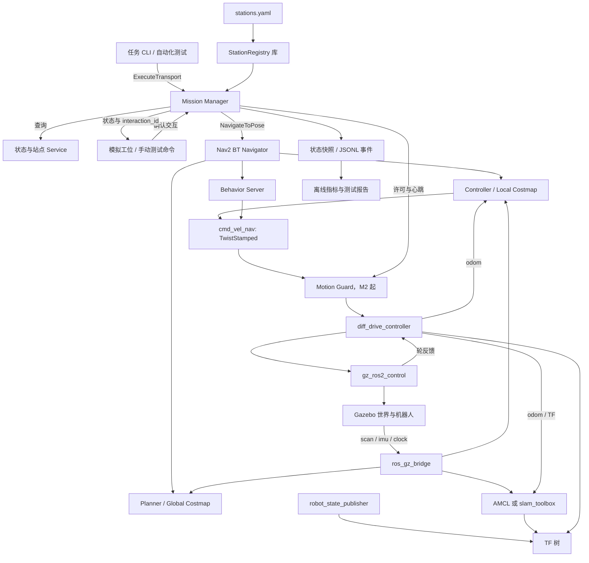
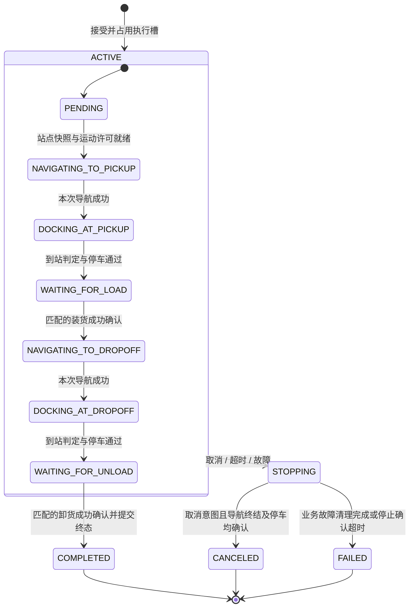
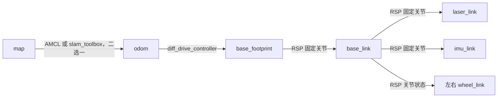

# 工业 AMR 自主导航与任务执行系统：项目设计与实施方案

> 2026-10-27：已按用户新请求进入实现。下面的“尚未实现”和逐里程碑授权限制保留为设计阶段历史；当前源码、运行方法与实测边界请查看 README.md 和 docs/validation.md。

**英文名称：** Industrial AMR Navigation & Mission System  
**文档版本：** v1.0，2026-10-23  
**状态：** 方案设计稿；尚未实现、构建或运行仿真。  
**输入依据：** `AMR_ROS2_Codex_Design_Prompt.md` 与本次“给出设计方案并保存为 Markdown”的请求。

本次按用户明确的保存要求交付设计文档与交接记录，覆盖参考提示词中“不修改文件”的限制；保留其“不编写项目代码、不安装依赖”的设计阶段边界。文中的目录、接口、配置示例和命令均是后续开发契约，不代表这些文件或功能已经存在。

已只读检查当前 Windows 项目目录，检查时目录为空，没有现存源码、README 或 HANDOFF.md。未检查 WSL 内的 `~/ros_ws`，因此“Ubuntu 24.04、ROS2 Jazzy、Gazebo Harmonic、已有机器人模型”均为用户提供的背景，不能视为本轮核实的环境事实。官方接口核对与本地运行验证分别记录，后者留给 M0。

**推荐主线：** M0 核对环境与复用资产 → M1 自动导航最小闭环 → M2 C++ 搬运业务闭环 → M3 故障与竞态回归 → M4 有数据支撑的导航优化。M5 按实际需求选择一个扩展，不作为项目成立的前提。

## 1. 项目概述与定位

### 1.1 应用场景与用户

在约 20 m × 15 m 的仓储/生产车间中，一台差速 AMR 执行取货站到送货站的运输任务。操作人员或测试客户端提交任务，站点模拟器分别确认装货、卸货；开发人员通过状态、日志与仿真数据定位故障。

任务示例为 `TASK-001: A01 → B02`。业务完成必须同时满足：任务被接受、取货导航完成、取货停靠条件满足、装货确认有效、送货导航完成、送货停靠条件满足、卸货确认有效。导航到达只是其中一个条件。

HOME 在第一版是待命站，不模拟真实充电、电池管理或充电握手。M2 在 B02 卸货成功即完成运输任务；返回 HOME 属于后续独立回位操作，不能因回位失败倒改运输成功记录。M1 的 A01 → B02 → HOME 只是导航烟雾测试，不包含装卸业务。

### 1.2 项目价值与职业定位

项目体现三类能力：正确集成 ROS2 导航系统；用 C++ 设计可测试的异步任务执行逻辑；用可重复实验分析系统故障及导航性能。用户已有的 C# 上位机、任务交互经验可迁移到业务建模、接口契约和故障处理，学习重点放在 ROS2 Action、TF、时间、控制数据链和 C++ 生命周期管理。

目标岗位是机器人系统软件、ROS2 应用开发、移动机器人导航工程及算法工程化。项目不定位为原创 SLAM 研究、深度学习研发、完整工业调度平台或经过认证的安全系统。

### 1.3 最终展示成果

- 可按文档复现的仿真系统及一条主 launch 命令。
- C++ Mission Manager：状态机、单任务互斥、Action 异步调用、取消、幂等与错误处理。
- 正常运输与故障场景的自动化回归、结构化记录及指标报告。
- 一个导航问题的基线、原因分析、改进与同条件对照实验。
- 架构图、接口说明、演示录像、测试证据与可讲解的核心代码。

## 2. 需求规格

### 2.1 功能需求

| 编号 | 需求 | 最早交付 | 验收依据 |
|---|---|---|---|
| FR-01 | 差速模型、轮反馈、LiDAR、IMU、仿真时间 | M1 | 传感器、TF、里程计和运动方向一致 |
| FR-02 | 固定地图导航，自动设置已知仿真初始位姿 | M1 | 无需重复点击 RViz 即完成三段导航 |
| FR-03 | 建图、保存地图、重启后加载定位 | M1 收尾 | 独立建图流程产物可重新用于定位 |
| FR-04 | YAML 站点读取、合法性校验与查询 | M1/M2 | 非法、重复、地图版本不匹配时不执行 |
| FR-05 | 自定义运输 Action 和 C++ 状态机 | M2 | 装货、卸货分别确认后才成功 |
| FR-06 | 同一任务 ID 去重、单车单任务、可取消 | M2 | 重复提交不产生第二次物理执行 |
| FR-07 | 不可达、无进展、超时、服务失联处理 | M3 | 在有界时间内恢复或给出明确失败 |
| FR-08 | 装卸成功、失败、重复和晚到消息处理 | M2/M3 | 无效确认不能推进状态机 |
| FR-09 | 结构化事件、状态查询、指标统计 | M2/M3 | 一笔任务可按 ID 还原过程 |
| FR-10 | 导航性能改进与定量比较 | M4 | 保留原始数据、配置和版本 |

### 2.2 非功能需求

| 编号 | 要求 | 设计约束 |
|---|---|---|
| NFR-01 | 可复现 | 固定世界、地图、站点、场景配置、种子和软件版本；记录硬件与实时因子 |
| NFR-02 | 可维护 | 纯 C++ 领域状态机与 ROS 适配分开；资源使用 RAII；禁止脱管线程 |
| NFR-03 | 有界执行 | 等待、重试、取消均设上限；不能用死循环等待 Action server |
| NFR-04 | 可观测 | 每次接受、拒绝、转移、导航结果、确认、取消都关联任务与会话 |
| NFR-05 | 便于迁移 | 参数与代码分离；资源由包 share 目录定位；模型、接口、仿真适配分开 |
| NFR-06 | 资源可控 | 小地图、低复杂度模型先运行；关闭 GUI 仍支持传感器和测试 |
| NFR-07 | 结果诚实 | 未运行的指标标为目标；估计位姿不充当真值；中断不假称续跑 |
| NFR-08 | 来源合规 | 仅使用公开依赖、自建场景与数据；保留第三方许可证与来源 |

### 2.3 MVP 边界与优先级

**导航 MVP（M1）**：一台车、三个站点、固定地图、普通到点导航、自动串行发目标、明确每段结果。先以无遮挡路径跑通，再验证一次障碍绕行。

**业务 MVP（M2）**：一个 `ExecuteTransport` Action、六站点配置、一次运输任务、独立模拟装卸、取消、运行会话内去重、结构化事件。不做排队、抢占、任务优先级或断点续跑。

**可靠性基线（M3）**：故障注入、停止确认、取消竞态、旧消息隔离、程序重启后的保守处理。M2 不能把这些语义留空，M3 负责扩大测试和完善边界。

多机器人、Open-RMF、复杂 WMS、Web/C# 界面、真实叉取、机械臂、学习式导航均排除在 M0–M4 外。SQLite、AprilTag、外部 HTTP 和真机移植属于可选 M5。

## 3. 仿真环境设计

### 3.1 布局与坐标

世界范围建议 `x∈[0,20] m，y∈[0,15] m`；墙体在边界内侧。地图坐标系 `map` 为二维右手系，x 向东、y 向北、z 向上，yaw 从 +x 方向绕 +z 逆时针增加，单位 rad。普通站点姿态表示机器人基座参考点的位置与朝向，不是货架或托盘中心。

以下为设计坐标，必须经过 M1 地图叠加、完整 footprint 碰撞检查和实际路径验证后冻结。

| 站点 | 类型 | x / y（m） | yaw（rad） | 用途 |
|---|---|---|---|---|
| A01 | PICKUP | 3.0 / 3.0 | 0.0 | 首个取货站 |
| A02 | PICKUP | 3.0 / 12.0 | 0.0 | 备用取货站 |
| B01 | DROPOFF | 17.0 / 3.0 | 3.141593 | 送货站 |
| B02 | DROPOFF | 17.0 / 12.0 | 3.141593 | 首个送货站 |
| C01 | BUFFER | 10.0 / 12.5 | 0.0 | 缓存展示；M2 不自动转运到此站 |
| HOME | HOME | 2.0 / 7.5 | 0.0 | 初始出生点与待命点 |

货架使用简单长方体，推荐放在 x=6–8 m 和 x=12–14 m 的带状区域，避开站点及上下横向通道。主通道净宽先设 1.5 m；另建长度约 4 m、净宽 0.8 m 的狭窄通道，供 M4 使用。狭窄通道必须配套绕行路径；永久阻挡测试另用封闭夹具，避免“堵住一条路”被误当成“目标不可达”。

M1 初始 world 只保留边界、两组货架和三个站点。站点标识是视觉提示，不应被误建成挡住机器人目标点的碰撞实体。复杂仓库、纹理、相机和装饰物后加。

### 3.2 AMR 参数与传感器

| 项目 | 初始建议 | 核验重点 |
|---|---|---|
| 底盘外形 | 约长 0.40 m × 宽 0.30 m，高约 0.20 m | 若轮子、保险杠外突，footprint 取实际碰撞包络 |
| 质量与惯量 | 总质量约 12 kg；各 link 按几何与质量计算 | 不使用零惯量或明显不合理的惯性矩 |
| 轮半径 / 轮距 | 暂定 0.05 m / 0.26 m | 轮距指左右轮中心间距，与 URDF 一致 |
| 驱动方式 | 左右轮速度控制，轮位置反馈 | 避免同时加载 Gazebo DiffDrive 与 ros2_control 驱动同一关节 |
| 初始速度上限 | 前进 0.35 m/s，转动 0.8 rad/s | 控制器、Nav2 与仿真限制保持一致 |
| 初始加速度上限 | 线速度 0.4 m/s²，角速度 1.0 rad/s² | 后续根据制动、跟踪与负载实测调整 |
| LiDAR | 360°、720 束、10 Hz、0.12–10 m | 安装高度约 0.18 m，障碍碰撞体需穿过扫描平面 |
| IMU | 50 Hz | frame、轴向、单位与协方差正确；M1 不因“有 IMU”就强行融合 |
| 里程计 / joint_states | 50 Hz / 50 Hz | 使用轮反馈；不是直接把速度命令当实测速度 |
| 控制更新 | 暂定 100 Hz | 配合 physics 步长约 0.001–0.002 s，确认算力足够 |
| 相机 | M1–M4 不启用 | M5 再引入内参、光学 frame、AprilTag 外参标定 |

基准测试先用无噪声或固定噪声配置，形成可诊断的基线；M3/M4 再加入固定种子的噪声和延迟场景。使用 GPU LiDAR 时，无 GUI 不等于无需渲染支持，应验证 WSL 的 EGL/渲染环境。

### 3.3 场景矩阵

| 场景 | 夹具 / 触发 | 预期 |
|---|---|---|
| S0 基线 | 固定出生点、无动态障碍 | 三站导航及完整运输成功 |
| S1 动态横穿 | 机器人进入指定区域后，实体以固定轨迹横穿 | 减速/等待/绕行，不碰撞；障碍离开后继续 |
| S2 临时阻挡 | 占用通道 5 s 仿真时间后移除 | 在预算内恢复，保留恢复事件 |
| S3 永久封堵 | 完全封闭目标入口，且无替代路径 | 有界失败；不能无限恢复 |
| S4 狭窄通道 | 净宽 0.8 m；相同出入口姿态 | 记录震荡、时间和最小间隙，用于 M4 |
| S5 传感器 / 时间异常 | 暂停、时间回拨、scan 停发 | 关闭运动许可、冻结或中止任务，不继续使用过期数据 |
| S6 业务异常 | 装卸失败、不响应、重复/晚到确认 | 按任务、阶段与交互 ID 精确处理 |
| S7 进程异常 | Nav2、Mission 或 guard 退出 | 明确失效与停止状态，不能自动重发旧运输 |

动态障碍必须同时具有可被 LiDAR 检测的几何与实际碰撞体。初期用箱体代替行人；只播放人物动画而不参与碰撞/扫描不能作为有效避障实验。

## 4. 技术选型

### 4.1 推荐与备选

| 子系统 | 推荐 | 选择理由 | 备选 / 本阶段不采用 |
|---|---|---|---|
| 平台 | WSL2 Ubuntu 24.04 + ROS2 Jazzy | 沿用背景环境、降低迁移成本 | 原生 Ubuntu 可作为性能回退；不先迁移发行版 |
| 仿真 | Gazebo Harmonic / Sim 8、ros_gz | 与 Jazzy 的官方配对一致 | 不使用 Gazebo Classic 教程直接替换插件 |
| 模型控制 | Xacro、robot_state_publisher、gz_ros2_control、diff_drive_controller | 传感器/运动链清晰，便于将来替换硬件接口 | Gazebo 自带差速插件只适合独立演示，不与本方案并启 |
| 建图定位 | slam_toolbox；运行期 map_server + AMCL | 建图与已知地图定位分模式，简化诊断 | 不在固定地图业务运行时同时启动两个 map→odom 发布者 |
| 全局规划 | Navfn，先使用已安装 Jazzy 示例的可用插件 | 足够支撑二维差速 MVP | Smac 2D 为后续比较项；不同时调多个规划器 |
| 局部控制 | DWB 起步 | 可观察采样、轨迹评价与局部避障，沿用成熟基线 | RPP/MPPI 在 M4 有明确问题和算力证据时比较 |
| 业务逻辑 | C++17、rclcpp/rclcpp_action、显式状态机 | 体现异步设计与故障控制能力 | 不自写业务 BT 引擎，不依赖 Python 完成核心逻辑 |
| 配置 | YAML + yaml-cpp | 站点规模小，审阅与版本控制简单 | M5 前不引入数据库 |
| 仿真辅助 | Python3/rclpy、pytest、launch_testing | 场景调度、设备模拟与报告生成方便 | 不发展成独立调度平台 |
| 测试 | GTest、ament_lint、launch_testing、rosbag2 | 领域逻辑、通信与物理仿真分层验证 | 不依赖人工 RViz 操作完成回归 |
| 可选精停 | AprilTag + opennav_docking 可行性验证 | 复用停靠框架，自己处理标定/观测/业务接入 | 不直接假设充电 dock 插件适合物料站 |

### 4.2 已核对的版本与接口事实

1. Gazebo 官方将 Jazzy 与 Harmonic 配对；`gz_ros2_control` 的 Jazzy 文档也对应 Harmonic，并由 Gazebo 插件实例化 controller manager。因此本方案不再额外启动第二个 manager 去控制相同关节。[Gazebo 官方配对说明](https://gazebosim.org/docs/harmonic/ros_installation/)、[gz_ros2_control Jazzy](https://control.ros.org/jazzy/doc/gz_ros2_control/doc/index.html)
2. Jazzy `diff_drive_controller` 的输入是私有话题 `~/cmd_vel`，类型为 `geometry_msgs/msg/TwistStamped`；里程计与可选 odom TF 由该控制器输出。本项目将该私有输入解析为 `/diff_drive_controller/cmd_vel`。[差速控制器接口](https://control.ros.org/jazzy/doc/ros2_controllers/diff_drive_controller/doc/userdoc.html)
3. Jazzy 支持用 `enable_stamped_cmd_vel` 切换 Nav2 的速度消息，不能按更新发行版的默认值推断 Jazzy 行为。Controller、Behavior、启用时的 Velocity Smoother 都必须检查。Behavior 的 Jazzy 实现使用 `nav2_util::TwistPublisher`。[Jazzy 迁移说明](https://ros-navigation.github.io/mkdocs.nav2.org/jazzy/configuration_and_development/migration_guides/iron/Iron/)、[Jazzy Behavior 源码](https://raw.githubusercontent.com/ros-navigation/navigation2/jazzy/nav2_behaviors/include/nav2_behaviors/timed_behavior.hpp)
4. 当前 Jazzy 分支的 `NavigateToPose` 目标包含 `pose`、`behavior_tree`，结果包含 `error_code`、`error_msg`，反馈包含 `current_pose`、`navigation_time`、`estimated_time_remaining`、`number_of_recoveries`、`distance_remaining`。开发时仍以本机 `ros2 interface show` 为准，不能从 Rolling 复制不存在的字段/错误常量。[Jazzy Action 定义](https://raw.githubusercontent.com/ros-navigation/navigation2/jazzy/nav2_msgs/action/NavigateToPose.action)
5. ros_gz 支持 LaserScan、IMU、Clock 等类型；时钟应 Gazebo→ROS 单向桥接，Gazebo 只提供一个时间源。若其实际话题是 `/world/<world>/clock`，桥接到 ROS `/clock`，不能假设 Gazebo 端必为 `/clock`。[ros_gz Jazzy 官方说明](https://raw.githubusercontent.com/gazebosim/ros_gz/jazzy/ros_gz_bridge/README.md)

以上是 2026-10-23 的在线资料核对，并非本地安装检查。发行版分支也会回补更新；M0 必须记录二进制包版本、overlay 来源和最终接口，不仅记录“Jazzy”。部分 docs.ros.org 页面无法直接读取，本轮改用官方仓库对应 Jazzy 源文件核对。

### 4.3 开发前必须补齐的事实

- WSL 发行版、图形渲染、CPU/内存、可用磁盘、真实实时因子。
- `/opt/ros/jazzy` 与已有 overlay 的先后顺序；是否混入 Humble/Rolling 包。
- 已有模型的尺寸、驱动插件、坐标系、传感器 frame、关节名和许可证。
- 本机 Nav2、ros2_control、ros_gz 的包版本与 Action/参数输出。
- M5 才核查 AprilTag 包和 opennav_docking 的具体插件/API 可用性；目前不承诺其可直接运行。

## 5. 系统总体架构



**任务流：** 客户端提交运输 → Mission 校验并占用单车执行槽 → 查站点 → 取货导航 → 停靠判定 → 等待装货 → 送货导航 → 停靠判定 → 等待卸货 → 返回一次最终结果。

**导航流：** Mission 仅调用 Nav2 的公共 Action；Nav2 BT 协调规划、控制和恢复。Mission 不自己计算路径，不把内部每次重规划当成一次新运输。

**传感器与控制流：** Gazebo 传感器经 bridge 进入 ROS；底盘关节经 gz_ros2_control 进入 controller manager；diff_drive_controller 根据轮反馈发布里程计。M1 速度可直接 remap 到差速控制器；M2 起加入同包内的轻量运动许可节点，禁止其他节点绕过它直发底盘命令。

**状态权属：** 业务任务状态唯一写入者是 MissionCore。Action feedback、状态 Topic、查询 Service 和日志都从同一状态快照派生；设备模拟器、Nav2 或 UI 均不能直接宣布业务完成。

## 6. 详细模块设计

### 6.1 模块、节点与自主开发范围

| 模块 / 包 | 主要节点或库 | 输入 → 输出 | 配置与依赖 | 自主开发边界 |
|---|---|---|---|---|
| amr_description | robot_state_publisher；Xacro 资源 | joint_states + 模型 → link TF | URDF、meshes；xacro、TF | 自建/整理模型、碰撞和惯量；复用发布节点 |
| amr_simulation | Gazebo、parameter_bridge、controller manager、scenario_controller | world/控制 → scan、imu、clock、关节反馈 | SDF、bridge.yaml、controllers.yaml；ros_gz、gz_ros2_control | 配置场景、传感器和故障夹具；不自写物理引擎 |
| amr_navigation | map_server、AMCL 或 slam_toolbox、Nav2；navigation_smoke | 地图/TF/scan/目标 → 路径、速度、导航结果 | nav2.yaml、地图、BT、RViz；Nav2 | 正确集成与调参；M1 测试客户端；M4 才决定是否扩展插件 |
| amr_interfaces | 消息生成，无常驻节点 | Action/Service/Msg 类型 | rosidl、标准消息 | 仅定义业务必需的稳定契约 |
| amr_mission | mission_manager、motion_guard、simulated_station；MissionCore、StationRegistry | 运输/确认/Nav2 结果 → 业务状态、下游动作、事件 | mission.yaml、stations.yaml；rclcpp_action、yaml-cpp、nav2_msgs | 重点自主实现；设备模拟可用 Python |
| amr_bringup | 主 launch、就绪检查、scenario_runner | 启动参数/场景 → 全系统与测试报告 | 包资源路径、测试配置 | 组织生命周期、启动/退出依赖与系统验收 |

Station Manager 第一版实现为 `StationRegistry` 库，装入 Mission 节点并提供查询 Service，不独立拆一个进程。站点少、只读配置，无需增加分布式缓存一致性问题。状态机库、Action 适配器与日志组件也先留在同一个包内。

### 6.2 Mission Manager 的内部职责

| 组件 | 职责 | 测试方式 |
|---|---|---|
| MissionCore | 状态转移、计时预算、货物状态、终态锁定 | 输入事件、断言输出命令和状态；无需启动 ROS |
| StationRegistry | 配置解析、唯一性/类型/地图绑定校验、只读查找 | 表驱动 YAML 与边界数据测试 |
| Nav2Adapter | goal 发送、handle 保存、feedback/result/cancel 回调标准化 | 可控的假 Action server |
| AdmissionRegistry | 当前执行槽、任务 ID 与请求内容指纹、终态缓存 | 同 ID、冲突内容、新 ID 并发提交测试 |
| DeviceAdapter | 对装卸确认进行任务/会话/阶段/交互匹配 | 重复、晚到、错误站点和超时测试 |
| EventRecorder | 顺序事件编号、JSONL、快照派生与日志故障通知 | 写入失败和一笔任务终态唯一性测试 |

初期采用单线程 executor 串行处理领域事件；所有 Action/Service 使用异步接口，回调内不 sleep、不同步等待 future，不用嵌套 spin。配置启动时读取；日志使用有界队列及受控写线程，线程可停止并 join，不持有可悬空的 Node 裸指针。日志失败触发事件后禁止接受新任务，活动任务按受控终止处理。

每个异步事件绑定 `(run_id, task_id, mission_epoch, nav_sequence, goal_uuid)`。设备事件还带 `interaction_id`。状态转移先比较代次和当前允许的事件，再执行副作用；错误代次的普通 feedback 被丢弃并记录。取消中的旧 goal 需要保留清理上下文，不能把晚到的“接受成功”一律忽略，具体见第 8 节。

### 6.3 Motion Guard：仅用于仿真故障边界

M2 起提供小型 `motion_guard`：它只接收 Nav2 速度并决定是否转发，不规划、不避障、不实现完整仲裁系统。它是差速控制器输入的唯一发布者，默认关闭；Mission 在合法导航阶段明确开启，并以 5 Hz 墙钟定时器提供心跳。许可关闭、心跳超过 1 s 墙钟未到或输入命令过期时，guard 输出零速度并锁定关闭，心跳恢复本身不能重新开启。Mission 监测到时钟停止推进、scan/odom/TF 过期时也主动关闭许可。

输入命令最大年龄先设 0.3 s 仿真时间，允许的时间误差须实测；旧命令不得通过刷新 stamp 伪装成新命令。关闭时生成带当前 ROS 时间的零速度。guard 进程退出由底盘命令超时提供第二道停命令机制；仿真暂停或时间回拨时保持关闭，恢复后必须重新通过就绪检查。

取消时先关闭许可，然后请求取消 Nav2；“许可已关闭”与“导航已结束”分开记录。许可关闭、控制器停命令、里程计低速只是仿真中的工程措施，不能称为经过安全认证的急停、防撞或可靠物理制动。

### 6.4 启动、退出与就绪门控

启动顺序为：Gazebo world → 模型生成与插件 controller manager → joint_state_broadcaster/diff_drive_controller 激活 → bridge 与 TF → map_server/AMCL → Nav2 lifecycle 激活 → 就绪检查 → Mission 可接任务。用条件和超时驱动，不用固定 sleep 代替就绪检测。

就绪需要同时满足：时钟推进、关键传感器新鲜、TF 可用、地图匹配、AMCL 初始化完成、Nav2 Action 可用且相关 lifecycle active、控制器 active、guard 可控、货物状态明确。仅 Action server 出现不等于整个系统可工作。

Mission 或关键进程异常退出时，主 launch 采用 fail-fast 退出关联系统；guard 心跳超时覆盖退出传播前的窗口。M3 验证这一行为。单独重启 Mission 不允许自动续跑或自动重新打开 guard。

## 7. ROS2 接口设计

### 7.1 任务入口：明确选择 Action

采用 `/mission/execute_transport`，类型 `amr_interfaces/action/ExecuteTransport`。运输耗时长、需要反馈与取消，适合 Action；Service + 后台任务需要另造反馈、查询和取消关联协议，M2 不采用。Action 自带通信状态不能代替业务状态，两者分别记录。[ROS2 Action 设计](https://design.ros2.org/articles/actions.html)

下面是拟定字段契约，不是已生成的 `.action` 文件。

| 区段 | 字段 / 类型 | 语义 |
|---|---|---|
| Goal | `task_id: string` | 1–64 字符，建议 `[A-Za-z0-9_-]`；一次业务执行的唯一 ID |
| Goal | `source_station: string`、`target_station: string` | 必须存在且分别支持取货、送货；M2 不接受同站 |
| Feedback | `run_id: string`、`state: uint8`、`current_station: string` | 当前会话、业务阶段与相关站点 |
| Feedback | `interaction_id: string`、`load_state: uint8` | 装卸交互关联及 EMPTY/LOADED/UNKNOWN |
| Feedback | `elapsed_sim_s: float64`、`distance_remaining_m: float32` | 仿真耗时；没有有效导航反馈时距离为 NaN，不能填 0 冒充到达 |
| Result | `run_id: string`、`task_id: string`、`final_state: uint8` | 本次最终业务结果 |
| Result | `error_code: uint16`、`message: string` | 本项目稳定错误码与可读原因 |
| Result | `load_state: uint8`、`requires_operator: bool` | 取消/失败后是否有货及是否需人工确认 |
| Result | `elapsed_sim_s: float64`、`elapsed_wall_s: float64` | 正常仿真耗时与单调墙钟耗时；回拨异常时前者标无效 |

`TRANSPORT` 已由 Action 类型表达，不再加入重复的 `task_type`；M2 不加入优先级、任意 JSON 或自动回 HOME 字段。状态值由接口统一定义，展示层不得各自解释字符串。

**接受/拒绝语义：** 在 goal callback 中完成轻量校验和原子占槽；非法请求、已存在 ID、BUSY、未就绪均拒绝，不进入任务状态机。ROS2 goal rejection 本身不携带本项目的自定义 Result，不能承诺被拒请求仍收到 `error_code`。拒绝原因通过带 Action goal UUID 的 admission 事件及日志提供；客户端查看原任务时使用查询 Service。若未来 HTTP 入口需要同步结构化拒绝响应，再在适配层增加契约。

### 7.2 业务 Service 与状态 Topic

| 名称 | 类型 | 请求 / 数据 | 返回 / 消费者 |
|---|---|---|---|
| `/mission/get_transport` | `GetTransport.srv` | `task_id` | `found` + `TaskSnapshot`，含运行/终态与结果原因；不存在时明确 UNKNOWN |
| `/stations/get_station` | `GetStation.srv` | `station_id` | `found`、类型、`PoseStamped`、`has_approach`、可选 approach pose、map_id |
| `/mission/confirm_operation` | `ConfirmOperation.srv` | `run_id, task_id, station_id, interaction_id, operation:uint8, outcome:uint8` | `accepted, reason_code, message`；operation=LOAD/UNLOAD，outcome=SUCCESS/FAILURE |
| `/mission/reconcile_load` | `ReconcileLoad.srv` | `run_id, load_state, operator_note` | 是否接受；仅无活动任务、导航已清理且静止时可更新 EMPTY/LOADED |
| `/mission/state` | `TaskSnapshot.msg` | 当前快照，5 Hz 并在状态变化时立即发 | CLI、设备模拟器和监控；reliable、transient_local、depth=1 |
| `/mission/events` | `MissionEvent.msg` | 有序事件，每个事件关联会话/任务/goal UUID | 监控；reliable、volatile、有界队列；不是持久历史查询 |
| `/diagnostics` | `diagnostic_msgs/msg/DiagnosticArray` | 1 Hz，就绪、失联、日志和运动许可状态 | 调试与测试 |
| `/motion_guard/set_enabled` | `std_srvs/srv/SetBool` | 显式开启/关闭转发 | guard 返回是否应用；Mission 是唯一业务调用者 |
| `/mission/heartbeat` | `std_msgs/msg/Empty` | 5 Hz，volatile | guard；仅维持已有许可，不能解锁 |

`TaskSnapshot` 最小包含 `run_id、task_id、transport_goal_uuid、state、source_station、target_station、current_station、interaction_id、load_state、error_code、message、requires_operator、event_seq`。其中 `transport_goal_uuid` 使用 `unique_identifier_msgs/msg/UUID`，供另一个 CLI 进程查询后通过标准 Action 取消服务定向取消；它与内部 Nav2 goal UUID 不同。无活动任务时 `task_id` 为空，另用诊断表示 READY/HOLD。`MissionEvent` 包含 `stamp、run_id、task_id、request_goal_uuid、event_seq、event_type、state、error_code、detail`；复杂测量数据写日志，避免扩大实时消息。

`reconcile_load` 只解决货物状态未知，不会解除失联 Nav2、残留 goal 或过期传感器导致的 HOLD。配置不提供运行中随意 reload；修改站点应在停机并重新验证后生效。

### 7.3 Nav2 Action 适配

| 项目 | 设计 |
|---|---|
| 地址与类型 | `/navigate_to_pose`，`nav2_msgs/action/NavigateToPose` |
| Goal 构造 | `PoseStamped.frame_id=map`，使用当前 ROS 时间；yaw 转单位四元数；目标来自冻结的站点快照 |
| behavior_tree | 不接受客户端任意路径；使用受版本控制、经安装资源定位的项目 BT |
| 发送条件 | 当前阶段匹配、就绪门控通过、前一 goal 已终结/清理、运动许可成功开启 |
| 反馈 | 用于距离/耗时/恢复次数观察；反馈缺失不直接等同于导航失败，更不等于到达 |
| 成功判据 | `WrappedResult.code=SUCCEEDED` 且本机接口支持的 Nav2 结果无错误；随后确认停车与到站条件 |
| 拒绝 | 没有 goal handle 时报告 NAV_GOAL_REJECTED；保持许可关闭 |
| 取消 | `async_cancel_goal` 定向取消保存的 handle，不默认 cancel_all；等待对应 goal 的最终结果 |
| 旧事件 | 普通反馈/结果先核对代次；残留 goal 接受回调必须进入清理路径 |

CancelGoal 返回成功只说明目标进入 CANCELING，不等于已经停止或已到终态。必须继续等待其结果或进入“取消未确认”的故障路径。[CancelGoal 官方接口](https://raw.githubusercontent.com/ros2/rcl_interfaces/jazzy/action_msgs/srv/CancelGoal.srv)

### 7.4 站点配置与校验

下面是配置设计示例，实际 YAML 文件留待 M1 创建。

```yaml
schema_version: 1
map_id: warehouse_v1
frame_id: map
stations:
  - station_id: A01
    type: PICKUP
    pose: {x: 3.0, y: 3.0, yaw: 0.0}
    docking_mode: nav_only
    load_timeout_s: 30.0
  - station_id: B02
    type: DROPOFF
    pose: {x: 17.0, y: 12.0, yaw: 3.141593}
    docking_mode: nav_only
    unload_timeout_s: 30.0
  - station_id: HOME
    type: HOME
    pose: {x: 2.0, y: 7.5, yaw: 0.0}
    docking_mode: nav_only
```

校验规则：ID 唯一且格式合法；类型来自白名单；所有数值有限；x/y 为米，yaw 为弧度且规范到 `[-π,π]`；MVP 只允许 map 坐标；map_id 必须与当前地图资源元数据一致；超时为正且不超过系统上限。目标须在地图已知自由区域且整个碰撞包络可放置，单个栅格自由不足以证明可停靠。配置检查也不能证明当前一定可达，最终仍依赖规划与执行结果。

M5 视觉停靠才为站点增加 `approach_pose` 与明确的 dock 标识/坐标约定：普通导航前往预停靠位姿，停靠模块负责最终对准。`nav_only` 不使用 approach_pose，避免导航停在预停靠点就误报完成。

### 7.5 机器人 Topic、发布权属与 QoS

| ROS 话题 | 类型 | 唯一来源 / 主要消费者 | 初始频率与 QoS 关注 |
|---|---|---|---|
| `/clock` | rosgraph_msgs/msg/Clock | Gazebo→bridge / 全部仿真时间节点 | 单一源；ClockQoS，避免双向桥和 wall time 覆写 |
| `/scan` | sensor_msgs/msg/LaserScan | Gazebo LiDAR→bridge / AMCL、Costmap、建图 | 10 Hz；SensorDataQoS、best_effort、volatile |
| `/imu` | sensor_msgs/msg/Imu | Gazebo IMU→bridge / 记录，可选 EKF | 50 Hz；SensorDataQoS；frame 与时间有效 |
| `/joint_states` | sensor_msgs/msg/JointState | joint_state_broadcaster / RSP | 50 Hz；沿用标准组件 QoS；不另桥一份 |
| `/odom` | nav_msgs/msg/Odometry | diff_drive_controller remap / Nav2、Mission 停车判定 | 50 Hz；消费端匹配实际发布者，检查协方差 |
| `/tf` | tf2_msgs/msg/TFMessage | 各自负责不同 TF 边的组件 / TF2 | 使用标准 TF QoS，禁止同一边多发布者 |
| `/tf_static` | tf2_msgs/msg/TFMessage | RSP 固定关节 / TF2 | reliable、transient_local；晚加入节点应收到 |
| `/map` | nav_msgs/msg/OccupancyGrid | map_server 或 slam_toolbox / AMCL、Costmap | 静态图 transient_local；两种模式互斥 |
| `/initialpose` | geometry_msgs/msg/PoseWithCovarianceStamped | 初始化辅助 / AMCL | 启动时发送或 AMCL 初始位姿参数；不周期性强制重置 |
| `/cmd_vel_nav` | geometry_msgs/msg/TwistStamped | Nav2 Controller/Behavior / guard | 约 20 Hz；volatile、短队列；BT 保证执行互斥 |
| `/diff_drive_controller/cmd_vel` | geometry_msgs/msg/TwistStamped | M2 起仅 guard / 差速控制器 | 约 20 Hz；reliable、volatile；超时与 stamp 有效性检查 |
| `/ground_truth/pose` | geometry_msgs/msg/PoseStamped（拟适配） | Gazebo 真值适配 / 测试评估 | 10–20 Hz；独立测试通道，禁止给 AMCL/Nav2 注入真值捷径 |

具体 QoS 以本机 `ros2 topic info --verbose` 验证。best_effort 传感器发布者无法满足要求 reliable 的订阅者；可靠发布者可以供兼容的 best_effort 订阅者使用。transient_local 不是跨进程重启数据库。[ROS2 Jazzy QoS 官方说明](https://raw.githubusercontent.com/ros2/ros2_documentation/jazzy/source/Concepts/Intermediate/About-Quality-of-Service-Settings.rst)

### 7.6 设备确认协议与去重

进入 WAITING 状态时 Mission 生成新的 `interaction_id`，发布操作、站点与截止时间。默认 `simulated_station` 使用 manual 模式；测试可选 scripted_success、failure 或 silent。自动成功模式必须由场景明确启用，并在等待阶段后独立延时确认，不能在收到导航成功时直接完成运输。

确认同时匹配会话、任务、站点、操作、交互 ID 及当前等待状态。首次有效 SUCCESS 只推进一次；相同交互和结果重发返回“已应用”且无副作用；同一交互不同结果返回冲突；迟到、错误会话或过期交互拒绝。超时先处理时，随后成功也不能把 FAILED 改成 COMPLETED。操作失败/超时后实际装卸状态可能不明，应设 UNKNOWN 并要求核实，不猜测为空或有货。

### 7.7 错误码与诊断范围

| 范围 | 名称示例 | 处理 |
|---|---|---|
| 0 | OK | 唯一成功值 |
| 100–109 | INVALID_REQUEST、UNKNOWN_STATION、DUPLICATE_TASK、TASK_ID_CONFLICT、BUSY | admission 拒绝；不计入已接受业务任务 |
| 200–219 | NOT_READY、NAV_UNAVAILABLE、NAV_GOAL_REJECTED、NAV_FAILED、NAV_TIMEOUT、NO_PROGRESS | 关闭运动许可，清理导航，失败并保留原始 Nav2 原因 |
| 300–319 | DOCK_CHECK_FAILED、LOAD_TIMEOUT、UNLOAD_TIMEOUT、DEVICE_FAILED、CONFIRM_CONFLICT | 业务失败或拒绝确认；按货物状态决定 HOLD |
| 400–419 | CANCEL_NOT_CONFIRMED、STOP_NOT_CONFIRMED、CLOCK_RESET、INTERRUPTED、LOG_IO_ERROR | 不自动再执行；人工确认或全栈重置 |
| 500 | USER_CANCELED | 已完成取消协议的业务取消 |

编号范围是本项目约定，具体整数在 M2 冻结。Nav2 原始结果与错误码另存字段，不能把其整数强行当作本项目枚举，也不能看到通用 ABORTED 就一律写“目标不可达”。

## 8. 任务状态机

### 8.1 主流程与统一终止通道



业务终态与机器人可接单状态分开：FAILED/CANCELED 已向客户返回结果后，机器人仍可能处于 HOLD。HOLD 由残留 goal、货物未知/已装载、导航失联、停止未确认等条件决定，不能因为 Action 已结束就释放运动资源。

保留 `DOCKING_AT_*` 业务阶段。M2 的 `nav_only` 在这一阶段做导航结果、位姿容差及停车检查，记录 `docking_method=nav_only`；它不执行视觉闭环，不承诺厘米级精度。M5 可替换此阶段，保持运输流程和装卸接口稳定。

### 8.2 完整状态转移规则

| 状态 | 进入条件 / 进入动作 | 成功退出 | 异常或取消退出 | 时间预算与重试 |
|---|---|---|---|---|
| PENDING | 请求已验证、执行槽已原子占用；建立上下文并记录 accepted | 就绪复核、站点快照、开启 guard 成功 → NAVIGATING_TO_PICKUP | 就绪丢失、配置/日志错误或取消 → STOPPING；无活动 goal 也检查运动关闭 | 最多 10 s 墙钟；不阻塞 executor |
| NAVIGATING_TO_PICKUP | EMPTY；发一个带新序号的 A01 目标 | 对应 goal SUCCEEDED → 关闭运动许可 → DOCKING_AT_PICKUP | goal 拒绝、失败、超时、通信故障、用户取消 → STOPPING | 每段共 180 s 仿真；goal 响应最多 5 s 墙钟；业务层不重发 |
| DOCKING_AT_PICKUP | 导航已终结；nav_only 复核位姿/停车 | 满足容差且静止 → 生成交互 ID → WAITING_FOR_LOAD | 到站条件不满足或取消 → STOPPING | 停车检查 3 s 仿真，另有 5 s 墙钟上限；不反复导航纠正 |
| WAITING_FOR_LOAD | 机器人静止，guard 关闭；开启 LOAD 交互窗口 | 首次有效 SUCCESS → LOADED → NAVIGATING_TO_DROPOFF | FAILURE/超时 → UNKNOWN → STOPPING；取消关闭窗口并保守标 UNKNOWN | 30 s 仿真；不自动重做装货 |
| NAVIGATING_TO_DROPOFF | 已明确 LOADED；发 B02 目标 | 对应 goal SUCCEEDED → 关闭运动许可 → DOCKING_AT_DROPOFF | 拒绝/失败/超时/取消 → STOPPING，保留 LOADED | 同上，每段总预算 180 s；不自动换站 |
| DOCKING_AT_DROPOFF | 导航已终结；nav_only 复核 | 满足容差和静止 → 新交互 ID → WAITING_FOR_UNLOAD | 判定失败/取消 → STOPPING，保留 LOADED | 同取货停车检查 |
| WAITING_FOR_UNLOAD | 静止且 LOADED；开启 UNLOAD 窗口 | 首次有效 SUCCESS → EMPTY → COMPLETED | FAILURE/超时/取消 → UNKNOWN → STOPPING | 30 s 仿真；不自动重做卸货 |
| STOPPING | 锁定终止原因，禁止发新 goal，关闭交互窗口与 guard；定向取消活动/晚接受 goal | 取消意图且全部终止/停车确认 → CANCELED；错误意图且清理完成 → FAILED | 超出清理预算 → FAILED，CANCEL_NOT_CONFIRMED 或 STOP_NOT_CONFIRMED；机器人 HOLD | 5 s 墙钟总预算；至多一次因通信失败的取消请求重试，不延长总预算 |
| COMPLETED | 卸货已确认，终态事件成功提交 | 无；不可变 | 重复/晚到确认只返回已应用或过期 | 释放执行槽，保留任务 ID 墓碑与结果 |
| FAILED | 业务故障终止；结果含货物和人工介入标记 | 无；不可变 | 新任务必须通过全部就绪/HOLD 检查 | 不以同 ID 自动重试 |
| CANCELED | 终止意图为取消、下游已终结、停车证据有效 | 无；不可变 | 有货/未知仍 HOLD，不能立即接受空载运输 | 不自动卸货或回 HOME |

全单额外设置 420 s 仿真截止时间及 900 s 墙钟保护，前者包含各阶段，先到者生效。上述数字是小场景验收初值，不是工业标准。若低实时因子导致墙钟保护先触发，应明确记为基础设施问题；不得静默延长预算以制造成功。

Nav2 自己的 BT 恢复属于导航子状态/事件 `RECOVERING`，不通过重入运输状态来清零计时。初始业务层重试为 0；BT 内部恢复轮数上限设为 2，并仍受每段 180 s 总截止时间约束。

### 8.3 取消协议与竞态裁决

1. 取消请求到达 Mission 后，若任务未终态且不在既有故障终止中，接受取消并锁定 `cancel_requested`；业务状态进入 STOPPING，而不是立即 CANCELED。
2. 禁止新副作用、关闭 guard、作废本次装卸窗口。已有导航 handle 时定向取消；尚未收到 goal 接受响应时记录“接受后立即取消”的义务。
3. 收到 cancel response 后记录“下游进入取消流程”，仍等待其最终结果。若导航已先成功/失败，终态也证明这个 goal 不再执行；取消已被上层接受时不再推进装卸或下一段导航。
4. 收到最终结果后检查停车：`|vx|<0.02 m/s、|wz|<0.05 rad/s` 持续 0.5 s 仿真时间，且 odom 新鲜、guard 已关闭。测试同时用 Gazebo 真值验证实际未继续移动；运行时里程计只能作为估计证据。
5. 导航终结和停车均得到确认后才返回 Action CANCELED。若期限内无法确认，返回 FAILED/ABORTED，携带清理失败码和人工介入标记；保持 HOLD，不编造取消成功。

**竞态规则：** 所有业务事件串行排序。若卸货成功已提交 COMPLETED，后到取消被拒绝，结果不变；若取消先被接受，后到装卸成功不能把任务改成成功，但应保留原始确认供人工核对。若故障终止先锁定，后到取消不覆盖原故障。

**发送目标超时的特殊处理：** goal 响应未到不等于服务器没有接受。此时 guard 关闭、机器人 HOLD，保留 pending-send 清理上下文。晚到接受回调必须取消该 handle，不能仅因 epoch 旧就丢弃。若永远无法确认，需重启/清理导航栈后才能接单；不能开始新任务后让旧目标重新获得速度转发机会。

### 8.4 幂等、互斥与资源占用

| 情况 | 决策 |
|---|---|
| 同 task_id、同 source/target，仍执行中 | 拒绝新 Action 为 DUPLICATE_TASK；查询原任务，不建立第二个执行流 |
| 同 task_id、同内容，已终态 | 拒绝重复执行；查询返回保存的终态 |
| 同 task_id、不同内容 | TASK_ID_CONFLICT；原任务记录保持不变 |
| 新 task_id，但执行槽被占用或清理未完成 | BUSY / HOLD；不排队、不抢占 |
| 两个请求同时到达 | 原子检查并预留执行槽；只能一个接受 |
| 同任务失败后希望重试 | 人工核对货物/机器人状态，提交新 task_id；旧 ID 不复用 |

M2 的去重保证限定在同一进程会话。终态缓存与 ID 墓碑整个会话保留，设置如 10,000 个 ID 的上限；达到上限停止接单并提示归档/重启，不用静默 LRU 淘汰破坏幂等。Action 自带的结果保留超时与业务缓存是两件事，业务查询不依赖 Action server 一直缓存旧 goal。

### 8.5 货物状态、中断与重启

正常链路为 EMPTY → 装货确认 → LOADED → 卸货确认 → EMPTY。装卸窗口内取消、失败或超时后设 UNKNOWN；在两段导航之间失败则保留最后已确认的货物状态。有货或状态未知时，不自动换任务、回 HOME 或伪造卸货。

M2 日志用于追溯，不宣称有事务恢复。进程重启后产生新的 run_id，默认 guard 关闭且货物 UNKNOWN，必须确认导航栈无残留执行并完成人工核对。完全重建干净仿真世界时，测试夹具可以依据显式“世界重置且空载”的事实解除 HOLD；单纯重启 Mission 不满足此条件。

没有持久化任务表时，重启后的查询对旧 ID 返回 UNKNOWN，不应假装能重建其精确状态；离线分析可把上次会话缺终态的接受记录标为 INTERRUPTED。跨重启任务 ID 去重和断点恢复均不作保证，上游不得自动重放旧 ID。M5 如增加 SQLite，也应首先实现“记录恢复后进入人工核对”，而非直接恢复运动；外部装卸副作用与数据库事务不能天然构成 exactly-once。

## 9. Nav2 集成设计

### 9.1 建图与定位两个互斥模式

**建图模式：** 启动机器人、轮里程计、scan、slam_toolbox；从固定起点低速采集完整仓库，确认闭环和关键通道后保存地图及其元数据。此时由 slam_toolbox 发布 map→odom，不启动 AMCL。

**业务运行模式：** 加载固定地图，启动 AMCL；已知仿真出生位置用于一次性初始化，不持续用真值纠正。等待 scan 匹配、map→odom 和基本定位稳定后再接收目标。验证地图版本与站点 map_id；地图变化后重新检查站点，不直接沿用旧坐标。

M1 先提供与简单几何 world 对齐的固定地图快速跑通导航，再补建图保存并用保存结果重跑三站测试。两个成果都属于 M1 验收，不能因为固定地图能跑就省略地图构建能力。

### 9.2 TF 发布权属



`base_footprint` 为地面投影参考点；模型里设置其到 base_link 的固定高度。差速控制器 `base_frame_id` 与 `/odom.child_frame_id` 使用 base_footprint，导航 robot_base_frame 也统一为 base_footprint。若复用模型只使用 base_link，可整体统一改用 base_link，但不能混用名称掩盖缺失边。

第一版不启用 EKF。若后续证明轮里程计需要融合 IMU，则轮里程计改发 `/wheel/odom` 且关闭其 odom TF；robot_localization 输出 `/odom` 并成为唯一 odom→base_footprint 发布者。Gazebo 真值与 joint_state 发布都不应额外桥接成同一 TF 边。

### 9.3 速度指令链

M1：Nav2 Controller/Behavior → 差速控制器。M2：Nav2 → `/cmd_vel_nav` → guard → `/diff_drive_controller/cmd_vel`。两种模式由 launch 明确选择，不能同一时间直连和经 guard 双发。

显式设置相关 Nav2 节点 `enable_stamped_cmd_vel=true`。M1 不启用 Velocity Smoother，先减少变量；如果 M4 测得速度跳变，再在 Nav2 与 guard 之间加入 smoother，检查其输入输出、超时及时间戳策略，防止持续转发已经失效的非零命令。[Jazzy Velocity Smoother 参数](https://docs.nav2.org/jazzy/configuration_and_development/configuration_guide/core_servers/configuring_velocity_smoother/)

Nav2 控制与恢复节点可能共享上游速度 Topic，二者由 BT 顺序协调；这不表示允许两个独立控制任务并发。MVP 不同时启动遥控、任务客户端和第二个 Nav2 goal 发送者。进入人工遥控前需终止任务并切换启动模式。

### 9.4 Planner、Controller、Costmap 与 BT

| 项目 | 初始方案 | 测量后再调整的内容 |
|---|---|---|
| Planner | `nav2_navfn_planner::NavfnPlanner`，选定一种搜索设置并记录；允许二维差速原地转向 | 无路率、路径长度、规划耗时；有理由再比较 Smac 2D |
| Controller | `dwb_core::DWBLocalPlanner`；vy=0，先限制低速 | 轨迹采样、评价权重、预测时域，先查数据再调参 |
| Global Costmap | map frame；StaticLayer + ObstacleLayer + InflationLayer | scan 更新速度、障碍清除、未知区策略 |
| Local Costmap | odom frame；rolling window 约 4 m × 4 m；ObstacleLayer + InflationLayer | 窗口、更新率和观测距离是否覆盖实际制动/绕行范围 |
| 碰撞模型 | 按实际外形定义多边形 footprint | 不能靠缩小 footprint 让窄道“通过” |
| Goal Checker | SimpleGoalChecker，初始 xy=0.15 m、yaw=0.15 rad | 单独统计到点误差与成功率；不是视觉精停指标 |
| Progress Checker | SimpleProgressChecker，初始 required_movement_radius=0.15 m、movement_time_allowance=15 s | 原地旋转/低速接近可能误判，结合 odom 和控制阶段诊断 |
| BT | 基于 Jazzy 官方重规划/恢复树，项目化固定一份 | 总恢复上限 2；配置变更受实验控制 |

插件标识、默认模板以 Jazzy 包资源为基线。官方 Jazzy 参数示例和 BT 可作为起点，但示例中的底盘尺寸、速度、扫描距离与恢复次数不能不加检查地照搬。[Jazzy 参数示例](https://raw.githubusercontent.com/ros-navigation/navigation2/jazzy/nav2_bringup/params/nav2_params.yaml)、[Jazzy 导航 BT](https://raw.githubusercontent.com/ros-navigation/navigation2/jazzy/nav2_bt_navigator/behavior_trees/navigate_to_pose_w_replanning_and_recovery.xml)

初始恢复保留代价地图清除与短时等待；Spin/BackUp 在验证旋转/后退空间与碰撞检查后再开启，狭窄通道先禁用盲目后退和大角度旋转。持续障碍应持续被 scan 标记；清地图不是把真实障碍从世界里删除。

Mission 的整段时间预算不因重规划、内部恢复或 feedback 更新而重置。Nav2 的恢复次数只是观察量，不能用“出现一次恢复”直接认定整个运输失败。

### 9.5 初始参数清单

| 参数项 | 项目初值 | 必须采集的证据 |
|---|---|---|
| 地图 / costmap 分辨率 | 0.05 m/cell | 通道占用边界、footprint 与精度预算 |
| footprint_padding | 约 0.02 m，结合实际模型复核 | 最小间隙与碰撞记录 |
| inflation_radius | 约 0.35 m | 走廊代价梯度，不能直接当硬障碍半径 |
| cost_scaling_factor | 暂从 3.0 起试 | 路径居中、路径可行性与局部震荡 |
| Global / Local 更新 | 2 Hz / 10 Hz | 实际周期、CPU、动态障碍响应 |
| 控制频率 | 20 Hz | 漏周期、命令年龄、跟踪误差 |
| 最大前进 / 角速度 | 0.35 m/s / 0.8 rad/s | 与底盘限制、制动距离一致 |
| scan obstacle / raytrace 范围 | 暂 5 m / 6 m，均不超过有效传感器范围 | 障碍出现/消失时的 costmap 变化 |
| transform_tolerance | 从 0.2 s 起验证 | TF 延迟、消息时间戳、外推错误；不得靠放大容差掩盖混用时间 |
| 底盘 cmd_vel_timeout | 0.5 s 初值 | guard 退出后停止情况；具体行为按安装版本验证 |

这些是项目初值，不是已优化参数。每次改变参数应说明目标症状、假设和回归场景；不要一次改十几项后无法解释改善来源。

### 9.6 仿真时间、QoS 与观测新鲜度

仿真、TF、导航、Mission、设备模拟、RViz 和测试节点统一 `use_sim_time=true`。里程计、scan、IMU、目标位姿共享 ROS 时间基准。默认 bridge 不把传感器 stamp 改成墙钟。

业务耗时与装卸截止时间使用 ROS 仿真时间；进程失联、guard 心跳、取消协议和整体防卡死使用单调墙钟。仿真暂停时业务计时冻结，但墙钟守护会关闭运动许可，超过策略预算则终止，不承诺任意长暂停后自动继续。时间回拨视为当前场景失效：终止任务、清理 TF/导航上下文并重新初始化。

新鲜度检查至少覆盖 `/clock` 是否推进、scan 和 odom 的 stamp/接收时间、TF 最新时间。ROS 时间未启动时不得发送 stamp=0 的运行目标。读取延迟高不能用扩大队列掩盖；先确认发布端、桥接、QoS、计算负载和时间域。

## 10. 目录和包结构

以下是后续建议结构，本轮不创建这些包。六个包分别对应模型、仿真、导航、接口、业务与系统组织；不把每个 C++ 类都拆成包。

```text
industrial_amr_ws/
├── README.md
├── HANDOFF.md
├── docs/
│   ├── design.md
│   ├── environment.md
│   ├── interfaces.md
│   └── experiments/
├── src/
│   ├── amr_description/
│   │   ├── urdf/          # Xacro：基座、关节、传感器、控制接口
│   │   ├── meshes/        # 优先简单几何，必要时添加网格
│   │   └── launch/
│   ├── amr_simulation/
│   │   ├── worlds/        # mini_warehouse、warehouse、故障夹具
│   │   ├── config/        # bridge.yaml、controllers.yaml
│   │   ├── scripts/       # scenario_controller
│   │   ├── launch/
│   │   └── test/
│   ├── amr_navigation/
│   │   ├── maps/          # 图像、YAML、map_id/生成说明
│   │   ├── config/        # nav2、AMCL、SLAM、RViz 参数
│   │   ├── behavior_trees/
│   │   ├── scripts/       # navigation_smoke
│   │   ├── launch/
│   │   └── test/
│   ├── amr_interfaces/
│   │   ├── action/        # ExecuteTransport
│   │   ├── msg/           # TaskSnapshot、MissionEvent
│   │   └── srv/           # 查询、装卸确认、货物核对
│   ├── amr_mission/
│   │   ├── include/amr_mission/
│   │   ├── src/           # Core、Registry、Adapter、Node、Guard
│   │   ├── config/        # mission.yaml、stations.yaml
│   │   ├── scripts/       # simulated_station、task_cli
│   │   └── test/          # 领域测试、假 Nav2、竞态测试
│   └── amr_bringup/
│       ├── launch/        # system.launch.py、mapping.launch.py
│       ├── scripts/       # readiness_check、scenario_runner、metrics_report
│       ├── config/        # suites、QoS 覆写、日志规则
│       └── test/          # launch_testing 与系统场景
└── artifacts/             # 每次运行的日志、bag、报告；不默认提交大文件
```

每个包具有标准 package.xml 与构建声明，接口包用 rosidl，C++ 包用 ament_cmake；Python 辅助脚本作为包可执行文件安装。配置资源通过 `ament_index_cpp` / `ament_index_python` 或 launch 的包 share 查找定位，不在代码中硬编码当前用户名或 `~/ros_ws`。

建议未来运行源码位于 WSL Linux 文件系统的独立目录，例如 `~/industrial_amr_ws`，不要把已有 `~/ros_ws` 直接改造成新项目。当前 Windows 目录只是本轮文档保存位置；M0 后再确定开发仓库和同步方式，避免对 Windows/WSL 两份代码同时修改。

主要 launch 契约为 `system.launch.py`，参数包括 `mode:=navigation|mission`、`world:=mini_warehouse|warehouse`、`use_sim_time:=true`、`gui:=false|true`、`rviz:=false|true`、`map:=...`、`stations:=...`、`device_mode:=manual|scripted_success|failure|silent`。只有 mode=mission 才启动 Mission、guard 和业务设备；默认设备为 manual，自动测试显式选择 scripted 模式。

## 11. 测试与验收

### 11.1 四层测试及执行边界

| 层级 | 方法 | 覆盖对象 | 环境要求 |
|---|---|---|---|
| L1 领域单元测试 | GTest + 假时钟/事件 | 状态表、幂等、预算、确认匹配、终态不可变 | ROS 构建环境；不启动 Gazebo |
| L2 ROS 集成测试 | launch_testing + 可控假 Nav2 | goal 拒绝、延迟接受、反馈乱序、取消拒绝/丢失、断连 | ROS2；无物理仿真 |
| L3 仿真系统测试 | 固定 world、scenario_runner、真实 Nav2 | 导航、TF、控制、装卸与停止效果 | Gazebo、渲染传感器支持 |
| L4 对照实验 | 固定场景与 A/B 配置 | 导航优化、精度/时间/成功率权衡 | 相同软件版本与机器条件 |

每次回归独立 ROS_DOMAIN_ID、独立进程组/场景目录，避免残留节点造成假成功。测试结束清理自身进程并检查底盘无命令残留；不粗暴结束用户其他 ROS 进程。默认串行跑完整物理仿真，只有 L1/L2 可按资源条件并行。

### 11.2 必须覆盖的测试用例

| ID | 场景与注入方式 | 必须断言 |
|---|---|---|
| T01 | A01→B02，设备在各等待窗口成功确认 | 一次接受、两段导航、两次独立确认、一次 COMPLETED |
| T02 | 动态障碍横穿/短时阻挡 | 不碰撞；预算内恢复；没有伪造业务成功 |
| T03 | 目标所在区域永久封闭 | 有界失败；保持停车，无无限恢复 |
| T04 | 不存在站点、错误类型、NaN/地图版本错误 | 拒绝任务或配置启动失败；没有 Nav2 goal |
| T05 | 同 ID 同内容重发、终态重发 | 原目标数/装卸次数不增加，查询一致 |
| T06 | 同 ID 不同目标；两个新 ID 同时提交 | 冲突拒绝；新任务最多接受一个 |
| T07 | 取货导航中、带货导航中、装卸等待中取消 | 仅清理后报告 CANCELED；货物状态按阶段处理 |
| T08 | Nav2 接受响应晚于用户取消或发送超时 | 晚接受 goal 被清理；不能启动下一任务覆盖旧清理上下文 |
| T09 | Nav2 SUCCEEDED 与取消近同时到达 | 按序列号只产生一个业务终态，无多发下一段目标 |
| T10 | cancel 被拒绝、无最终结果、odom 不再更新 | 不报告取消成功；超时 FAILED + HOLD |
| T11 | 装卸 silent、FAILURE、重复 SUCCESS、相反结果 | 超时/失败明确；确认幂等；冲突不改已有结果 |
| T12 | 旧 run_id / 旧 interaction_id 晚到确认 | 拒绝；不影响当前任务或新等待窗口 |
| T13 | Nav2 未启动、lifecycle 非 active、执行中退出 | 准入拒绝或执行失败；运动许可关闭 |
| T14 | Mission/guard 进程退出 | 心跳/底盘超时按预期生效；无自动续跑 |
| T15 | clock 暂停与回拨、scan/TF 过期 | 仿真与墙钟策略可解释；不使用旧时间推进任务 |
| T16 | 有货/未知状态重启后提交任务 | HOLD，人工核对前不接受运输 |
| T17 | 日志不可写、记录队列溢出 | 暴露故障并限制任务；不能静默丢失关键终态 |
| T18 | 所有用例后读取事件轨迹 | 接受任务恰好一个终态或明确 INTERRUPTED；无非法状态跳转 |

竞态用假 server 直接控制事件先后，不靠反复手动点取消碰运气。物理测试使用真实传感器、控制和 Action 链，不能只用“模拟成功回调”替代。

### 11.3 指标定义与采集口径

| 指标 | 计算与数据源 | 注意事项 |
|---|---|---|
| 导航成功率 | 成功导航 goal 数 / 发起的导航尝试数 | 一个新的 goal 为一次尝试；被拒、响应未知或失败也保留在分母，另列分类；内部重规划不新增尝试 |
| 任务成功率 | COMPLETED 数 / 被接受的唯一业务任务数 | 重复/BUSY/非法拒绝另报；接受后取消/失败/中断均在总口径分母 |
| 导航/任务耗时 | 接受到终态及各阶段时间差，分别报仿真时间和单调墙钟 | 成功任务耗时与失败/取消终止延迟分开，避免幸存者偏差 |
| P95 | 排序后取第 ceil(0.95×N) 个值，同时给 N、均值、中位数 | 小样本 P95 不稳定，不能不报样本量 |
| 临时障碍恢复率 | 注入后仍在预算内成功的案例 / 对应注入案例 | 注明阻挡持续时间、位置与重复数 |
| 明确失败上报率 | 在预算内得到符合预期错误及终止记录的案例 / 预期失败案例 | 与取消成功、物理停车确认分别统计 |
| 取消延迟 | 上层接受取消到业务 CANCELED/FAILED 的墙钟间隔 | 同时报停止命令、低速判定和 Nav2 终态三个时间 |
| 碰撞次数 | Gazebo 接触监测或独立几何检查，统计机器人与墙/货架/障碍物的意外接触 | 排除轮地等正常支撑接触；没有有效监测时只能说“未观察到”，不能断言零碰撞 |
| M5 停靠精度 | 真值误差：平面距离及规范化角度差 | 估计误差单独列；预先固定 map/world 对齐与时间同步，不能按每次结果拟合对齐来抹去误差 |
| 资源指标 | 实时因子、CPU/内存、控制周期、scan/TF 延迟 | 解释机器变慢对成功率与墙钟耗时的影响 |

同一轮实验按场景分组：正常业务、故障演练、取消演练分别出报表，另外提供全量统计。不能用大量故障注入压低成功率后又选择性删除；也不能把取消算成功导航。goal 响应未知的尝试应列为 unknown outcome，并在保守总体成功率中保留分母。

### 11.4 项目验收目标——尚未实测

| 阶段 | 项目目标 |
|---|---|
| M1 | 连续 5 轮 A01→B02→HOME，共 15 段全部有真实结果；基线 15/15 成功；无需逐段 RViz 点击 |
| M1 收尾 | 建图保存后重新启动定位与导航，并至少完整跑通一轮三站流程 |
| M2 | 10 次基线运输全部完成，10/10；每次完成有独立装卸证据；重复提交零重复执行 |
| M3 | 正常场景至少 30 单，目标成功率 ≥95%；故障场景各至少 5 次，语义断言全部通过 |
| M3 | 可控模拟取消在 5 s 墙钟预算内明确结束或上报清理失败；旧回调导致非法转移为 0 |
| M3 | 具备有效接触检测的场景中碰撞次数为 0；达不到则停止性能扩展，先排查 |
| M4 | 同条件基线/候选配置各至少 30 次；预先选定一个指标，如狭窄通道 P95 耗时下降 ≥15%，同时成功率不下降、碰撞不增加 |
| M5 可选 | 真值评估下初步目标 P95 平面误差 ≤0.05 m、角度误差 ≤3°，至少 30 次；达不到如实报告 |

以上是本项目自定验收门槛，非已达成结果或行业标准。若某基线本来没有明显问题，不应故意调坏它再展示提升；M4 应基于真实复现的失败或低效现象重新确定实验目标。

### 11.5 事件、日志与复现实验包

每次运行创建 `artifacts/<run_id>/`，保存 `manifest.yaml`、`events.jsonl`、`metrics.json`、必要的 rosbag 与报告。manifest 记录 UTC 日期、软件包版本、Git 提交（若已建仓）、world/map/stations/参数内容哈希、种子、出生点、RMW、ROS_DOMAIN_ID、硬件和 GUI/headless 模式。

事件至少含：run_id、task_id、event_seq、ROS stamp、单调墙钟偏移、from/to_state、interaction_id、nav_sequence/goal_uuid、错误域/错误码、取消意图与下游状态。每笔任务终态只提交一次；允许 admission 拒绝事件不产生已接受任务记录。

bag 主要录制 scan、imu、odom、tf/tf_static、clock、map、cmd_vel_nav、控制器输入、任务状态/事件及真值评估通道；必要时显式加入 Nav2 Action feedback/status 的实际话题名。Action result 在客户端结构化日志中记录，不能假设普通 rosbag 自动保存所有 Action 服务往返。对 transient_local 等话题按实际情况提供录制 QoS 覆写。

rosbag 适合离线分析，不自动等价于重新执行交互仿真。可靠复现依靠固定场景、输入、种子与版本重新运行；bag 用于解释差异。报告给出原始样本和失败列表，不只放一张成功截图。

### 11.6 构建、运行和测试命令契约

本节均为未来命令，须在 M0 确认后的 WSL Ubuntu 终端执行。`system.launch.py`、辅助可执行文件和测试套件目前尚不存在，必须由相应里程碑实现。文中的工作路径只是建议，不代表已创建。

```bash
# 未来工作空间中的标准构建
source /opt/ros/jazzy/setup.bash
cd ~/industrial_amr_ws
colcon build --symlink-install --cmake-args -DCMAKE_BUILD_TYPE=RelWithDebInfo
source install/setup.bash

# M1：启动导航；另一个已 source 的终端运行自动三站测试
ros2 launch amr_bringup system.launch.py mode:=navigation world:=mini_warehouse gui:=false rviz:=false use_sim_time:=true
ros2 run amr_navigation navigation_smoke --stations A01 B02 HOME --repeat 5

# M2：启动业务模式；默认人工确认设备
ros2 launch amr_bringup system.launch.py mode:=mission world:=warehouse device_mode:=manual use_sim_time:=true
ros2 action send_goal /mission/execute_transport amr_interfaces/action/ExecuteTransport "{task_id: 'TASK-001', source_station: 'A01', target_station: 'B02'}" --feedback

# M2/M3：配套 CLI 获取当前交互 ID、确认和定向取消
ros2 run amr_mission task_cli status --task-id TASK-001
ros2 run amr_mission task_cli confirm-current --task-id TASK-001 --operation LOAD --outcome SUCCESS
ros2 run amr_mission task_cli confirm-current --task-id TASK-001 --operation UNLOAD --outcome SUCCESS
ros2 run amr_mission task_cli cancel --task-id TASK-001

# L1/L2：常规自动测试；L3 单独运行，避免每次单元测试拉起 Gazebo
colcon test --packages-select amr_mission amr_navigation amr_simulation --event-handlers console_direct+
colcon test-result --verbose
ros2 run amr_bringup scenario_runner --suite m3_regression --headless --seed 42
ros2 run amr_bringup metrics_report --input artifacts --output artifacts/report.md
```

主 launch 与提交/确认命令分别在不同终端使用，示例不是让同一个阻塞 shell 串行执行全部命令。`task_cli` 的取消功能应查询并定向取消已关联的业务 goal UUID，不能实现成无条件取消所有任务。实际状态不是等待装/卸货时，`confirm-current` 必须拒绝而不是盲目填充交互 ID。

## 12. 里程碑开发计划

### 12.1 优先级、依赖与工作量


| 阶段 | 优先级 | 前置条件 | 预计专注工时 | 阶段完成产物 |
|---|---|---|---|---|
| M0 | P0 | 用户明确启动开发 | 4–8 h | 环境清单、版本证据、复用决策与风险清单 |
| M1 | P0 | M0 明确可运行环境 | 20–36 h | 简单场景、机器人、地图/定位、自动三站导航与 15 段结果 |
| M2 | P0 | M1 稳定，导航 Action 链可用 | 28–44 h | C++ Mission、接口、装卸模拟、guard、正常流程及基本异常测试 |
| M3 | P0 | M2 业务状态明确 | 20–32 h | 完整故障矩阵、竞态测试、回归与指标报告 |
| M4 | P1 | M3 基线可重复 | 16–28 h | 基线与改进配置、对照数据、实验报告 |
| M5 | P2 | M4 完成且确有需求 | 每项约 12–40+ h | 单项扩展与独立验收；精停/真机可能更久 |

M0–M4 合计约 88–148 h，不含环境重大修复；建议额外预留约 25% 排障缓冲。按每周 10 h 估算，含缓冲约 11–19 周。估算用于安排节奏，不作为完成承诺；每个阶段验收后再校准下一阶段工时。

### 12.2 M1 最小任务清单——优先实现这条链

每一项都能单独运行和验收，依赖未通过时不向后堆功能。

| 顺序 | 最小增量 | 完成证据 | 参考工时 |
|---|---|---|---|
| 1 | 在新工作空间放入最小 world 与一个合法差速模型 | Gazebo 无穿地/爆炸；模型尺寸/碰撞可见 | 3–5 h |
| 2 | 接通 gz_ros2_control 与左右轮控制器 | 直行/转向正确，停止命令生效，控制器 active | 3–5 h |
| 3 | 接通 clock、scan、imu、joint_states、odom 和 TF | 频率、frame、stamp 与发布者检查记录 | 3–5 h |
| 4 | 加载与 world 一致的固定地图和 AMCL | map→odom→base 完整，scan 与地图对齐 | 3–5 h |
| 5 | Nav2 单目标导航 | 一次 A01 导航有真实反馈/结果；失败可定位 | 3–5 h |
| 6 | 自动顺序执行 A01→B02→HOME | 5 轮、15 段，逐段结果；某段失败停止链条 | 2–4 h |
| 7 | 独立建图、保存、重启定位，再跑一轮 | 地图产物、来源说明、复跑记录 | 3–7 h |

阶段内保留轻量 README 说明已完成的链路。完成这些步骤之前，不开发复杂任务 UI、相机精停或数据库。

### 12.3 M0：环境与已有资产评估

**业务目的：** 确定“在哪里跑、哪些能复用、哪个冲突必须先解决”，避免覆盖以前练习或混用环境。

**模块与任务：** 只读识别 WSL 发行版、ROS overlay、Gazebo/Nav2/控制器版本、渲染能力；检查已有工作空间、包、模型与 launch；列出复用、局部修整、新建、暂不使用四类资产。当前 Windows 空目录不代表 WSL 没有旧项目。

**输入依赖：** 用户现有环境和可公开使用的模型位置；没有旧代码也可按新建方案前进。复用前确认资源来源，不读取或迁移公司专有资产。

**后续只读检查命令示例：**

```bash
# Windows PowerShell 中：确认实际 WSL 发行版名称
wsl --list --verbose

# 进入相应 Ubuntu 发行版后执行
cat /etc/os-release
printenv ROS_DISTRO
printenv AMENT_PREFIX_PATH
gz sim --versions
ros2 doctor --report
ros2 pkg prefix nav2_bringup
ros2 pkg prefix gz_ros2_control
ros2 interface show nav2_msgs/action/NavigateToPose
dpkg-query -W 'ros-jazzy-nav2*' 'ros-jazzy-ros-gz*' 'ros-jazzy-gz-ros2-control' 'ros-jazzy-ros2-controllers'

# 存在旧工作空间时，先进入并确认目录，再读取包/版本状态
colcon list
```

`colcon list` 必须在确认的旧工作空间运行；若为 Git 仓库，再读取 `git status --short` 与 remote，不擅自重置用户修改。记录关键渲染/依赖缺失即可，评估阶段不顺手升级全套系统。

**验收与必要测试：** 明确版本配对、插件来源、模型复用路径；给出最小“Gazebo 能启动且传感器可出数据”的检查结果或具体阻碍；决定后续独立工作空间位置。

**典型失败与排查：** 包不存在→核对 source 和包安装；找到错误发行版→检查 AMENT_PREFIX_PATH；模型打不开→核对资源 URI、依赖与路径；WSL 黑屏→检查渲染能力，并用小场景验证服务端和传感器，而非直接删改环境。

**产出 / 工时：** `environment.md`、版本输出、复用/重构/新建清单，4–8 h。没有旧资产时默认全部新建，保留旧目录不动。

### 12.4 M1：最小自动导航 MVP

**业务目的：** 用最少组件证明一台机器人能可靠接收自动目标、定位、运动并返回结果。

**涉及模块：** description、simulation、navigation、bringup；不依赖 Mission Action。任务按 12.2 顺序完成，站点配置先三个，world 先简化。

**输入依赖：** M0 版本与模型决策；固定世界几何；可运行控制链。

**运行命令契约：**

```bash
ros2 launch amr_bringup system.launch.py mode:=navigation world:=mini_warehouse use_sim_time:=true gui:=false
ros2 run amr_navigation navigation_smoke --stations A01 B02 HOME --repeat 5

# 建图独立运行，不与上面的 AMCL 导航模式同开
ros2 launch amr_bringup mapping.launch.py world:=mini_warehouse use_sim_time:=true
ros2 run nav2_map_server map_saver_cli -f artifacts/maps/warehouse_v1 --ros-args -p use_sim_time:=true
```

保存地图前创建对应产物目录；地图文件经检查后才安装到包资源。建图运动采用已核对的 stamped 遥控模式或受控采图路线，不与业务导航并发。复跑时停止建图模式，加载新地图并初始化 AMCL。

**验收：** 达到第 11.4 节 M1 门槛；有 TF、Topic 类型与控制器状态检查记录；任意段失败必须停止后续发目标并报告具体阶段/原始结果。

**必要测试：** 传感器连通性、直行转向、停车、地图对齐、单点、三点、一个非法目标、一次短时障碍；记录 headless 运行实时因子。

**典型失败：** 有 cmd_vel 无运动→按 13.2 查类型/订阅/控制器；scan 与墙错位→查外参和 map→odom；机器人绕圈→查轮距、左右轮、角速度符号与定位；无路径→先看地图/目标/footprint，而不是先替换规划器。

**产出 / 工时：** 基础包、主 launch、地图与建图说明、自动导航脚本、15 段报告、README，20–36 h。M1 通过后冻结一份可复现基线。

### 12.5 M2：C++ Mission Manager 与完整业务闭环

**业务目的：** 从“到三个点”推进为“可追踪的一笔运输”，体现 C++ 与机器人业务软件能力。

**涉及模块和增量顺序：** 接口包与纯状态机测试 → StationRegistry → Nav2Adapter → 正常运输 → 设备确认 → 幂等/互斥 → 取消清理 → motion_guard/就绪门控 → 日志与 CLI。每一步保持已有 M1 导航测试可运行。

**输入依赖：** 已冻结的地图/站点/导航配置，稳定的 NavigateToPose；不在同一阶段大改控制器算法。

**运行命令契约：** 使用 11.6 的 mission launch 与 `ros2 action send_goal`，手动验证至少一次完整装卸；自动批量验收通过：

```bash
ros2 run amr_bringup scenario_runner --suite m2_happy_path --repeat 10 --seed 42 --headless
colcon test --packages-select amr_mission --event-handlers console_direct+
colcon test-result --verbose
```

scenario_runner 负责独立启动测试系统、显式启用 scripted_success，并清理自己启动的进程；不要在已有手动系统上重复拉起第二套节点。

**验收：** 10 单完成；同 ID 不重复导航/装卸；有任务时新 ID 被拒绝；取消不立即假成功；等待装卸必须由独立确认推进；日志可还原任务。

**必要测试：** 主流程全部状态、未知站点、BUSY、重复任务、目标拒绝、装卸超时、导航中取消、guard 心跳丢失；竞态通过假 Nav2 先建立最小覆盖。

**典型失败：** 回调内等 future 导致卡死→检查 executor 与同步等待；同一任务跳两阶段→检查交互去重与终态提交；取消后下一段继续运动→查取消锁与异步代次；旧目标仍执行→查 pending-send 清理。

**产出 / 工时：** C++ 库和 Node、业务接口、设备模拟、CLI、状态/错误码文档、正常流程证据，28–44 h。

### 12.6 M3：异常处理与可靠性

**业务目的：** 让系统在异常时能停止、解释并保持状态一致，避免只会演示成功流程。

**任务与模块：** 补齐 T01–T18；扩展假 Nav2 的接受/取消/结果延迟控制；完善 guard、日志与重启 HOLD；加入固定种子的障碍夹具、版本 manifest、指标统计；补退出和资源生命周期检查。

**输入依赖：** M2 业务接口冻结，正常流程稳定，M1 导航配置保持可追溯。

**运行命令契约：**

```bash
colcon test --packages-select amr_mission amr_simulation amr_navigation --event-handlers console_direct+
colcon test-result --verbose
ros2 run amr_bringup scenario_runner --suite m3_regression --headless --seed 42
ros2 run amr_bringup metrics_report --input artifacts --output artifacts/m3_report.md
```

**验收与必要测试：** 第 11.4 节 M3 门槛；故障各至少 5 次；L2 控制竞态次序而非随机碰撞；结构化日志中每个 accepted 任务有一个终态或 INTERRUPTED 标记；无旧事件推进新任务。

**典型失败：** 所有测试偶发超时→先比较 RTF/墙钟/ROS 时间；两个 Nav2 实例互抢目标→查进程隔离和 ROS_DOMAIN_ID；终态日志重复→查单一写入点；Nav2 失联仍运动→查 guard 许可与心跳关闭，不只延长 Action 超时。

**产出 / 工时：** 可一键运行的回归、故障报告、资源生命周期说明、可复现失败样本，20–32 h。未达门槛先修复，不提前进入性能包装。

### 12.7 M4：选择一个导航问题做优化

**优先题目：** 0.8 m 狭窄通道中，低速推进时反复调整朝向或长期停滞。只有基线确实复现时采用；否则从动态障碍后的恢复耗时等实际问题中选择。

**步骤：** 固定场景/起点/目标和 30 个种子或配对样本 → 采基线 → 查看 global path、局部 costmap、速度符号变化、footprint、scan 与 TF 延迟 → 提出单一原因假设 → 一次改一类因素 → 同配置重复 → 全部 M3 关键用例回归。

可能的改进优先级为：修正模型/时间/代价地图错误 → 调整合理参数 → 比较成熟插件 → 只有明确缺口才自研一个小扩展。参数优化和工程集成本身可以成为成果，不为了“有算法代码”复制已有规划器。

**输入依赖：** M3 无已知关键竞态/停止问题，固定基线版本与场景。

**运行命令契约：**

```bash
ros2 run amr_bringup scenario_runner --suite narrow_aisle --profile baseline --repeat 30 --seed 42 --headless
ros2 run amr_bringup scenario_runner --suite narrow_aisle --profile candidate --repeat 30 --seed 42 --headless
ros2 run amr_bringup metrics_report --input artifacts --compare baseline candidate --output artifacts/m4_comparison.md
```

**验收：** 达到预先登记的改善目标，同时任务/导航成功率不下降、没有新增碰撞；完整展示失败样本和代价。样本少或波动大时扩大样本或报告证据不足，不能只挑最好的一次。

**典型失败：** 改完很快但碰撞增多→检查 footprint/代价模型被不合理放宽；只有某一轮改善→核对随机种子/障碍触发/RTF；新控制器跑不动→先做单场景兼容验证，不把整套参数一起替换。

**产出 / 工时：** 问题说明、数据、参数 diff、原始试验记录、前后视频与结论，16–28 h。

### 12.8 M5：选择一个扩展，不并行铺开

| 扩展 | 业务目的与实现边界 | 输入依赖 | 运行入口设计 | 验收与典型问题 | 工时粗估 |
|---|---|---|---|---|---|
| AprilTag 精确停靠 | 预停靠导航后视觉相对位姿闭环；停靠与装卸仍独立 | 相机内参/外参、tag 真值、Jazzy 插件核验 | `system.launch.py docking:=vision`；`scenario_runner --suite docking_accuracy` | 真值 P95、tag 丢失/误检/过期、TF 标定、超时退出；不会因检测到 tag 就宣布停靠成功 | 24–40+ h |
| SQLite 持久化 | 任务/事件/幂等键落盘，重启可查询中断记录 | 已冻结状态模型和日志协议 | `system.launch.py persistence:=sqlite`；`scenario_runner --suite restart_recovery` | 崩溃后只恢复记录并 HOLD；不能自动重做装卸；检查事务边界/磁盘错误 | 12–20 h |
| HTTP 适配 | 对外提交/查询，展示与上位机交互能力 | Action/查询/取消稳定 | `ros2 run amr_mission http_gateway`，作为拟定入口 | 断线重连、重复提交、取消映射；网关不另存可修改的业务状态 | 12–20 h |
| 真机移植 | 替换仿真硬件接口，验证真实里程计/传感器 | 有硬件与场地、驱动文档、独立安全措施 | `system.launch.py backend:=hardware use_sim_time:=false` | 标定、延迟、打滑、负载和停止距离；仿真成功不代表现场合格 | 40+ h，需另行评估 |

表中 M5 参数和可执行文件也是未来契约，不属于 M1–M4 必须实现的入口。精停优先核查 opennav_docking 的站点插件与非充电场景支持，并验证与本机 Jazzy 版本的对应关系。[官方 Docking Server 说明](https://docs.nav2.org/jazzy/configuration_and_development/configuration_guide/core_servers/configuring_docking_server/)

若选择视觉停靠：普通 Nav2 goal 必须先终结并关闭导航速度权限，随后只允许 docking 控制源；M2 guard 需按这一明确需求扩展受控源切换，不能同时转发导航与精停速度。扩展测试同时覆盖停靠失败后运输不进入装卸、目标丢失后停止和取消期间清理。

## 13. 风险和技术难点

### 13.1 风险登记与降低办法

| 风险 | 表现 / 影响 | 降低办法 | 发现阶段 |
|---|---|---|---|
| WSL/Gazebo 性能或渲染问题 | 实时因子低、传感器无数据、GUI 卡死 | 小 world、简单碰撞、关闭 GUI；验证 headless 传感器；必要时评估原生 Ubuntu | M0/M1 |
| Twist / TwistStamped 不匹配 | 有发布却无订阅匹配，车不动 | 显式开启 stamped；逐跳查类型和 QoS；不靠改话题名猜测兼容 | M1 |
| 多驱动/多 controller manager | 轮速跳变、接口抢占、重复 odom | 只保留 gz_ros2_control 一条驱动链；验证关节资源唯一声明 | M1 |
| TF 多发布者/缺边 | 位置跳跃、外推、导航漂移 | 发布权属表；map→odom 二选一；odom TF 只由一个源提供 | M1 |
| 仿真时间混用 | 目标过期、costmap 不更新、超时异常 | 全链 use_sim_time；单向 clock；分别记录仿真/墙钟 | M1–M3 |
| 过期速度经中间节点重新盖时间戳 | 上游失联但底盘持续动 | 禁止刷新非零旧命令的有效期；guard 检查命令与心跳；故障注入 | M2/M3 |
| Action 异步竞态 | 取消后新任务被旧回调污染 | 单线程领域事件、代次校验、pending-send 清理、终态一次提交 | M2/M3 |
| 无法确认取消 | 客户端以为已取消，底盘仍有执行 | guard 先关、等待终态与停车、失败进入 HOLD | M2/M3 |
| 设备确认语义不足 | 一条 Bool 让错误任务装卸成功 | 使用 run/task/station/operation/interaction 组合；幂等响应 | M2 |
| 无持久化却宣称幂等/续跑 | 重启重复运货、状态无法核对 | 明确会话保证；重启默认 UNKNOWN/HOLD；M5 再做持久化 | M2/M5 |
| 完美仿真掩盖真实误差 | 真机打滑、延迟、遮挡和负载导致失败 | 加噪声/延迟实验；清楚标注仿真范围；真机另设验收 | M3/M5 |
| 过度拆包/过早扩展 | 无可运行闭环、学习负担高 | 六包上限作为初始结构；以每阶段可验收产物驱动 | 全程 |

### 13.2 排障模板与一个具体例子

后续每次故障记录使用：**症状 → 数据流 → 根因假设 → 排查步骤及命令意义 → 正常/异常解释 → 根因与修复验证**。先检查数据链，再调整导航参数。

示例症状：Nav2 显示导航执行中，但车不动。

数据流应为 Nav2 Controller/Behavior → cmd_vel_nav → guard → 差速控制器 → 左右轮 → 轮反馈/odom。可能原因依次包括：无可行路径、消息类型/QoS 不匹配、guard 未授权、控制器未激活、轮接口错误、命令时间过期或仿真暂停。

| 检查命令（未来运行环境） | 意义 | 正常 / 异常如何解释 |
|---|---|---|
| `ros2 action list -t` | 看 Action 名称与类型 | 无 navigate_to_pose：未启动或发现域错误；存在仍需检查 lifecycle |
| `ros2 lifecycle get /controller_server` | 检查 Nav2 控制器状态 | 非 active 时不会正常控制 |
| `ros2 topic info /cmd_vel_nav --verbose` | 检查速度类型、发布订阅者与 QoS | 类型/可靠性不兼容导致不通信；publisher 数异常先查重复节点 |
| `ros2 topic echo /cmd_vel_nav --once` | 查看速度与 stamp | 没数据：上游或时钟问题；一直零：查规划/状态，不能强行加大速度 |
| `ros2 topic echo /diff_drive_controller/cmd_vel --once` | 检查最终输入 | 上游非零而此处零：先查 guard 许可/新鲜度 |
| `ros2 control list_controllers` | 查 controller manager 管理的控制器 | diff_drive_controller 非 active：检查启动和关节资源 |
| `ros2 control list_hardware_interfaces` | 查轮关节命令/状态接口 | 未导出或未被声明：模型/插件配置问题 |
| `ros2 topic hz /odom` | 检查反馈是否持续更新 | 无反馈不能确认运动或停车 |
| `ros2 run tf2_ros tf2_echo map base_footprint` | 检查导航位姿链 | 无变换/跳变：检查定位与 TF 权属 |
| `ros2 topic echo /clock --once` | 查看是否存在仿真时间 | 还需连续观察是否推进；只有一条样本不能证明正在运行 |

确认根因后只修改相关配置，再重跑单点与三站测试并记录前后证据。例如“将 Nav2 全链改为 TwistStamped 后订阅匹配恢复、控制器收到新鲜输入、15 段导航通过”才构成闭环验证；目前没有执行这项验证，不能写成已修复事实。

### 13.3 C++ 工程难点的学习交付

每个关键增量随代码解释五点：对象各自管理什么；事件从哪个回调进入；当前状态允许哪些事件；失败/取消后谁清理什么资源；哪些单元测试可以不启动仿真就证明逻辑正确。

优先阅读自己的 MissionCore、Nav2Adapter、StationRegistry，再沿数据链阅读需要用到的 Nav2 源码。先理解一条正常导航与一条取消路径，不以“读完整个 Nav2 源码”作为开始项目的前置条件。

## 14. 简历与面试展示价值

### 14.1 能力与证据的对应

| 能力 | 可展示成果 | 面试应能解释 |
|---|---|---|
| ROS2 系统集成 | TF 权属图、QoS/时间核验、统一 launch | 为什么每条 TF 边只能有一个权威来源，为什么有 Topic 却收不到数据 |
| C++ 工程能力 | 领域状态机、异步适配器、RAII、可控假 server | callback 生命周期、取消竞态、旧事件隔离、如何避免阻塞 executor |
| 机器人导航工程 | 地图/定位/控制链与一个优化实验 | map/odom 的区别、Costmap/footprint、规划与局部控制分工 |
| 业务建模 | 幂等、执行互斥、装卸协议、货物状态 | 为什么导航成功不能代表运输成功，为什么重复消息不能重复装货 |
| 排障与质量 | 故障矩阵、结构化日志、真实失败案例 | 如何从症状沿数据流定位根因，如何证明修复而非偶然成功 |
| 指标意识 | 成功率、耗时、P95、对照实验与原始样本 | 分母怎么定，取消怎么算，真值与估计值为什么分开 |

### 14.2 完成后才能填写的简历表述模板

以下仅是待填模板，不能在未实现时直接作为经历使用：

- 基于 ROS2 Jazzy、Gazebo Harmonic 与 Nav2 构建单车仓储运输仿真系统，贯通传感器、轮里程计、TF、定位和自动导航；在固定场景完成 **[N]** 次导航，成功率 **[实测值]**。
- 使用 C++17 实现运输 Action 与业务状态机，处理单任务互斥、运行会话内幂等、装卸关联确认和异步取消；以 **[N]** 类故障/竞态测试验证终态一致性与有界失败处理。
- 针对 **[真实复现的问题]** 分析 **[数据与根因]**，通过 **[具体改动]** 将 **[指标]** 从 **[基线]** 改善到 **[结果]**，并保留 **[样本数]** 次对照记录与回归结果。

必须明确这是个人仿真项目。复用 Nav2/SLAM 不等于自行研发导航/建图算法；参数优化不应包装成原创规划器；未部署真机不写“工业现场稳定运行”；没有安全认证不写“工业级安全系统”；没有多车调度不写“车队调度平台”。

### 14.3 推荐演示顺序

控制在约 5–8 分钟：展示一条运输任务与两次独立装卸 → 插入一次短时障碍 → 演示一次取消和货物状态 → 打开该任务日志/测试 → 展示 M4 对照结论。演示时失败也应有明确结果，避免只有预录的成功导航画面。

README 至少包含环境版本、快速启动、架构、接口、状态机、测试命令、实测结果、限制、第三方来源。面试准备围绕“一个正常流程、一个竞态、一条数据链、一次优化实验”，每个都能定位到自己的代码与证据。

## 15. 待确认问题与推荐决策

### 15.1 仅保留三个会影响实施路线的问题

| 问题 | 为什么影响路线 | 推荐默认决策 |
|---|---|---|
| 现有差速模型/launch 在哪个 WSL 目录，是否完全来自可公开使用的个人练习？ | 决定 M0 复用范围与 M1 建模成本 | 先只读审计；能复用就最小整理，找不到或来源不清就新建简单模型 |
| WSL 的实际算力、渲染和可用资源是否支持小场景 headless 传感器？ | 决定继续 WSL、缩小场景或评估原生 Ubuntu | 默认继续 WSL、小 world、无相机；M0/M1 用实测结果决定是否调整 |
| 项目第一轮优先投递 ROS2/C++ 系统软件还是强调视觉精停的导航岗位？ | 决定 M4/M5 的展示重点，不影响 M1 起步 | 默认以 ROS2/C++ 系统软件与导航工程为主，先完成 M0–M4；精停可选 |

这些问题不阻塞本轮方案交付，也不要求现在一次回答所有细节。除资产路径和环境实测需要后续确认外，其余按默认建议实施。

### 15.2 已给出的默认决策

- Ubuntu 24.04 + Jazzy + Harmonic；安装版本以 M0 证据为准。
- 一台差速 AMR；六站点最终布局，M1 先三站；先固定地图、后补建图保存复跑。
- Navfn + DWB + AMCL；第一版无 EKF、无视觉精停、无数据库。
- `ExecuteTransport` Action 是业务入口；站点为同进程只读库；不做排队或抢占。
- M2 运输完成点是 B02 卸货确认；回 HOME 独立，不倒改运输结果。
- 去重仅保证当前会话；重启先 HOLD；持久化与恢复另立验收。
- 异常、取消和装卸边界从 M2 就明确，M3 系统化验证。
- 正常运行不从真值注入定位；评估时独立使用 Gazebo 真值。
- 所有数字目前均为初值、估算或验收目标，没有实测成绩。

### 15.3 最推荐的第一个开发里程碑

**先完成 M0 的短评估，随后只进入 M1：在最简单的仓储世界中，用真实 Nav2 Action 结果跑通无需逐段点击 RViz 的 A01 → B02 → HOME。**

M1 的第一个具体增量是“最小 world + 一台差速车 + 正确的控制、传感器、时间和 TF 链”，其后再接 AMCL/Nav2。通过 15 段自动导航与建图保存复跑后，再开发 C++ Mission Manager。后续只有用户明确要求进入某个里程碑时才开始编码；每次只交付一个可测试增量，并附设计解释、运行命令、真实验证结果与剩余问题。


