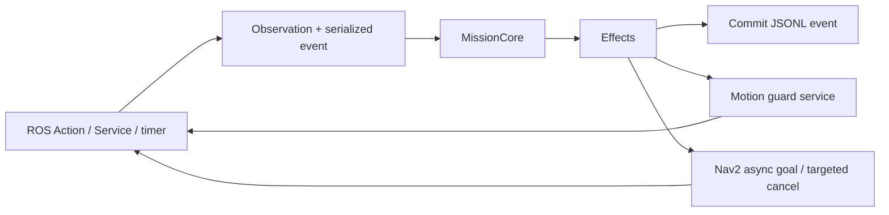

# 核心实现导读

`MissionCore` 是纯 C++17 领域对象，拥有当前任务、会话内 ID 墓碑、确认去重表、阶段截止时间和导航清理上下文。它接收 `Observation` 和串行事件，输出 `Effect`。自身没有线程、ROS 依赖或文件 IO，因此可用假时间精确测试竞态。

`StationRegistry` 启动时一次性读取站点和地图。除了 schema、角色、ID、有限数值和超时，还检查 PGM 占用栅格与旋转后的完整包络：对每个候选栅格作矩形分离轴判断，拒绝未知、占用或越界，包括很小的角部重叠。地图 ID 必须同时出现在站点和地图 YAML，资源改变后由 manifest 哈希保留证据。

`MissionNode` 拥有 ROS Action server/client、查询/确认 Service、TF buffer、定时器与日志文件。默认单线程 executor；goal callback 校验并占槽，accepted callback 取得业务 goal handle 后才处理副作用。定时器和 ROS 回调都将事件交给同一个 Core，无后台脱管线程，也不在回调内同步等待 future。

发导航前 Core 分配递增代次、请求 guard；许可回应成功且就绪仍有效时才发送一个 NavigateToPose。普通反馈/结果须匹配代次。取消锁定 STOPPING，立即撤销许可和装卸窗口，有 handle 时定向取消；没有接受响应时保留 pending 标记。晚接受回调仍保存 handle 并执行取消，不能因为它已经“旧”就丢弃。

停车与下游终结是两项证据。odom 超过新鲜度预算，或尚未持续低速 0.5 s，都不能报告 CANCELED。清理预算结束仍不明确则 FAILED + 故障锁定；即使稍后旧 goal 终结，保守故障锁也不自动解除。只更新货物核对不足以清除残留导航或时钟回拨。

Nav2返回未分类ABORTED（错误码0或结果缺失）时，也不能假定其内部子目标已清理。适配器记录nav_context_invalidated，Core锁定故障（空载也需人工介入），拒绝新任务与货物核对；有界终止后保留短结果通信窗口，再由主launch关闭全栈。BT子动作/服务确认预算为1000ms，独立于180s仿真导航和5s墙钟清理预算；真实Nav2 BT延迟确认测试覆盖原20ms失败及修正预算成功。

导航期间guard意外撤权同样锁定故障，空载也不能通过货物核对恢复任务。世界可保留以便诊断停止状态，但必须重建全栈后才能再次执行。正常到站和主动取消所请求的guard关闭不属于意外撤权。

`MotionGuard` 是独立 C++ 进程。只有显式 enable 能开启转发，心跳只维持许可。传感器、时钟、心跳、速度异常均撤销许可。尚未收到第一条命令时最多等待 5 s；最后输入为非零时，命令过期或间隔超过 0.4 s 会撤权。明确的零命令允许 Nav2 在恢复 Wait 期间保持许可和静止，但所有心跳与传感器门控仍有效。非零命令仅在输入回调中转发并保留原 stamp，定时器不会重放缓存命令；明确零输入和 disabled 状态均输出 guard 自己的新鲜零命令。底盘还具有 0.5 s 命令超时。

Nav2原始命令先经过原生`collision_monitor`，再进入MotionGuard。实时激光近障区域为0.80×0.64m、2点触发停止；带余量足迹用1.5s碰撞时间、0.05s步长预测减速，激光源0.4s失效时停车。它不使用Gazebo真值；真值仅用于独立评估。stamped转发保留源header。导航模式也经过此层，建图不经过导航控制链。

`readiness_monitor` 检查 Nav2（含collision_monitor）lifecycle、轮控制器、地图/AMCL、TF 与 clock/scan/imu/odom；物理就绪与业务货物/HOLD 分开。主 launch 对关键节点采用 fail-fast。整个世界退出后的物理状态无法继续测量，因此进程退出测试只证明退出传播和中断语义，不将此包装为真机停车认证。

`lifecycle_coordinator` 先等待物理就绪，配置并激活 map_server/AMCL；定位就绪后再依次启动控制器、规划器、行为和 BT。所有服务请求异步且有墙钟超时；响应丢失后先查询实际状态，再决定是否迁移，避免重复 configure。启动总预算为 120 s。建图模式使用相同机制启动 slam_toolbox。它与就绪门控、关键进程退出传播共同管理本项目的节点生命周期。

机器人生成后由同一个原生controller_manager spawner加载joint_state_broadcaster和diff_drive_controller，并成组激活。此方式消除原先先退出一个spawner、再新建第二个参与者发现管理器服务的启动路径；就绪门控仍核对两个控制器实际active及新鲜odom/TF。m0_startup套件独立验证反复启动，不计作运输成功。

每个关键事件先写入并 flush JSONL，再对外发布事件或结果。日志写失败直接退出，依靠 guard 心跳与底盘命令超时关闭运动窗口；未提交的成功不会发给客户端。它不提供事务恢复，进程重启生成新 run_id、货物 UNKNOWN、旧任务查询 UNKNOWN。`reset_world_empty` 仅由创建新世界的主 launch 显式设置；单独重启 Mission 默认不核对为空载。

评估链为 Gazebo `amr::TruthSystem` 读取 ECM 的模型 worldPose → 原生 Gazebo Transport → `gz_truth_bridge` 保留实体名和源时间戳 → `truth_monitor`。插件只读物理状态，不修改位姿、力或速度；该链不向 AMCL/Nav2 发布定位。评估器另记录单调墙钟，用于时钟暂停/回拨的证据关联。

本机 Gazebo 的时间重置会移除通过 UserCommands 动态生成的机器人。该场景视为全栈上下文失效：Mission 先记录原始 CLOCK_RESET，关闭准入与运动许可，完成有界任务失败处理，短暂保留结果通信窗口后退出；launch 随之关闭关联进程。无需等待失效世界恢复原任务，也不把缺少真值包装为停车证明。
