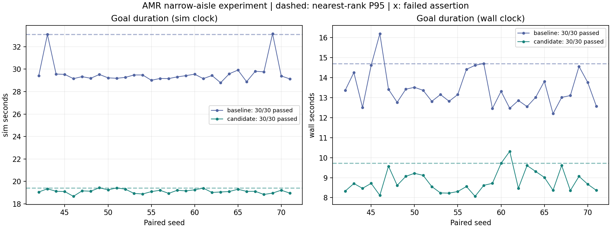
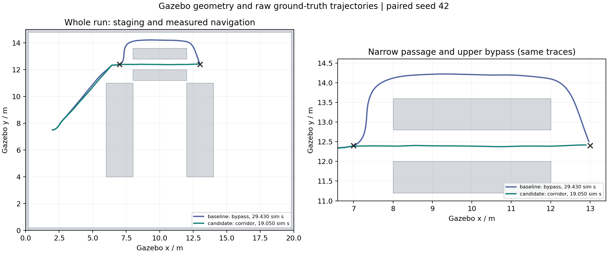
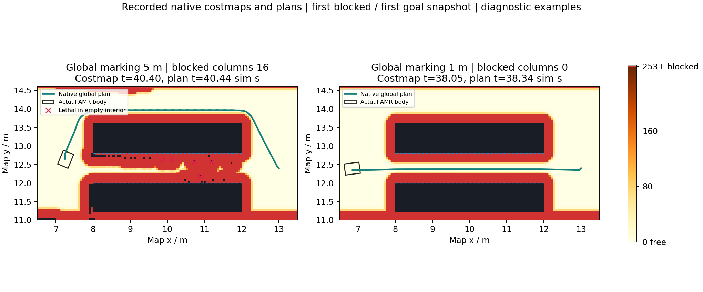

# 固定窄道导航实验结果（v10）

2026-10-29。预登记的仿真耗时P95目标达成：**33.092 → 19.414秒，下降41.33%**。两组各30次均成功、记录接触0、真值及实际停车验证全部有效；基线30次绕行，候选30次实际穿越。

候选只用于narrow_aisle的固定实验路径（含staging）。仓库运输继续使用基线；请求candidate系统策略时，warehouse场景的effective_profile也是baseline。该策略隔离另经15/15真实系统场景回归验证，**不代表40/1m数值参数在仓库通用**。不限定范围的仓库候选曾失败，原始记录保留。

## 正式数据

| 指标 | Baseline | Candidate |
|---|---:|---:|
| 正式样本 / 成功 | 30 / 30 | 30 / 30 |
| 仿真均值 / s | 29.604 | 19.117 |
| 仿真中位数 / s | 29.408 | 19.111 |
| 仿真P95 / s（主指标） | 33.092 | 19.414 |
| 墙钟均值 / s | 13.427 | 8.802 |
| 墙钟P95 / s | 14.707 | 9.716 |
| controller进程CPU秒均值 | 3.366 | 2.182 |
| 实际RTF均值（目标均为3） | 2.212 | 2.179 |
| 真值路径长度均值 / m | 8.297 | 6.018 |
| 路线 | bypass 30 | corridor 30 |
| 通道内部侧墙最小物理间隙 / m | 未穿越，不作此统计 | 0.209611 |
| 记录接触 / 未验证真值 / 未验证停车 | 0 / 0 / 0 | 0 / 0 / 0 |

同一机器、相同目标倍率、headless串行新世界，配对seed42–71。staging为HOME→(6.5,12.4)→(7,12.4)，计时到(13,12.4)，朝向0。P95取排序后第ceil(.95×30)=29项；包括所有样本和较慢的基线记录，没有剔除异常值。预检两条及系统回归15条均排除正式性能统计。

实际RTF没有达到3，且两组略有差异；墙钟、CPU总秒与仿真运动耗时分别报告，CPU总秒不等于算法复杂度。Gazebo seed也不完全控制AMCL与调度，因此这是本机固定场景样本结果，不是跨机器或真机性能承诺。



[全部60行CSV](figures/v10_samples.csv)保留请求/实际配置、成功、接触、真值、停车、耗时、CPU、路径与间隙；[机器可读汇总](figures/v10_summary.json)保留完整精度与图表SHA-256。

## 路线与机制证据

下图是正式seed42的完整Gazebo轨迹，包含staging；叉号为计时入口/出口。图例耗时属于这个样本，不是P95。基线走上方绕行，候选沿0.8m通道通过。



候选的两项差别均限全局规划：inflation衰减3→40，激光标记距离5→1m。局部仍5m观测、原生监控仍使用完整原始scan；物理足迹、padding、速度、预测、停止阈值均保持。两项共同构成候选，不归因于单一参数。

仅提高衰减的旧候选没有稳定通过。独立原生诊断三次中两次失败，记录到15–16列通道被>=253代价封闭、物理空旷中央带出现5/9个254致命格。当前AMCL位置误差较小，清图后闭合格消失，支持观测层遗留/投影误差相关的解释，尚未逐项隔离所有误差来源。固定40、仅缩短全局标记距离的独立诊断3/3通过，未再记录闭合列或中央致命格。

下图选取一次失败中的首次闭合快照，以及近距离观测对照的首次目标快照，注明各自时间。黑色为254障碍、红色为253不可通行区，叉号为物理空旷带中的致命格。它是故障诊断示例，不能代替上面的30对统计。



缩短全局标记距离也缩短了全局对动态障碍的提前规划距离；局部检测和物理监控仍保留。仓库货架转角使用这组数值曾安全停机并任务失败，因而工具将其限定为固定窄道实验，仓库运输维持已验证基线。

## 审计与可复现文件

[最终审计JSON](figures/v10_acceptance_audit.json)的complete_and_consistent和overall_acceptance_passed均为true，issues为空。当前交付源码、43项自动化、M1、正常30单、M3 75项、策略回归15项、正式A/B 60项及所有登记门槛均核对通过。

M1/M2/M3复用已完成基线证据；公共生产运行代码和baseline有效参数保持一致。完整源码版本数2，公共源码版本数1；仅允许已登记candidate片段、精确harness坐标/策略解析/元数据及资源测试修订。旧源码快照、旧新SHA和精确文本检查保留，不能任意豁免其他变化。

- [正式60行CSV](figures/v10_samples.csv)、[完整候选Nav2文件](figures/v10_candidate_nav2.yaml)。手动生成结果已与实际候选参数逐字节比较一致，仓库误用返回2且不生成文件。
- 完整本地产物位于 `artifacts/validation/final_acceptance_v10/`，含原始日志、manifest、真值、地图和参数，未纳入源码仓库；[证据说明](../evidence/README.md)列出公开范围和复现入口。总体报告还包含预检/故障，不能拿其中narrow组的31条替代正式30条。
- [完整报告](../evidence/final_acceptance_v10_report.md)区分请求profile和effective_profile。182条场景记录全部断言通过；120个被接受运输任务含故障演练，54完成/24取消/30失败/12中断，不能将其45%混合成功率当成正常运输率。
- 退出/重置场景共18条保留真值/停车不可验证标记；不把世界消失视作停车证据。正常运输30单和本实验60条的真值/停车全部验证有效。

## 旧失败与负预检

以下各组独立保留，均不进入v10统计。

| 批次 | 事实 | 独立报告 |
|---|---|---|
| v5 | 候选12仍绕行；自动队列停止4通过/1中断 | [预检](../evidence/history_m4_v5_preflight_report.md)、[停止批](../evidence/history_m4_v5_stopped_report.md) |
| v6暂停批 | 小时级UTC跳变，2条一过一失败 | [暂停批](../evidence/history_m4_v6_pause_report.md) |
| v6新鲜环境 | 20通过/1失败；近入口转向被NearStop停止 | [入口失败](../evidence/history_m4_v6_entry_report.md) |
| v7 | 两端各留1m后基线安全通过，候选18仍绕行 | [负预检](../evidence/history_m4_v7_preflight_report.md) |
| v8 | 基线30/30，候选40为3/4；虚假全局屏障后绕行停车 | [完整负结果](../evidence/history_m4_v8_negative_report.md) |
| v9 | 窄道40/1m预检通过，仓库正常运输失败203/LOADED/HOLD、0接触 | [仓库边界](../evidence/history_m4_v9_warehouse_report.md) |

原生诊断完整数据另存本地 `artifacts/validation/navigation_probe_fullrange/` 与 `artifacts/validation/navigation_probe_nearfield/`，未纳入源码仓库；机制图已保留在本报告中。[预登记协议](protocol.md)及v1–v9归档保留每次修改理由。

在项目PowerShell终端完整复跑（耗时较长，使用全新输出名）：

```powershell
$amrRunName = 'reproduce_' + [DateTime]::UtcNow.ToString('yyyyMMddTHHmmssZ')
./tools/run_acceptance.ps1 -Stages all -OutputDirectory "artifacts/$amrRunName" -EvidenceName $amrRunName
```

采样结束后，在已source的Ubuntu终端执行`python3 tools/audit_acceptance.py --input <Linux验收根> --require-performance`，将数据完整性与性能目标一起作为退出码门槛。若需重收证据，collect_evidence只接受同源目录；不同实验使用不同名字，不删除旧失败来凑样本。
