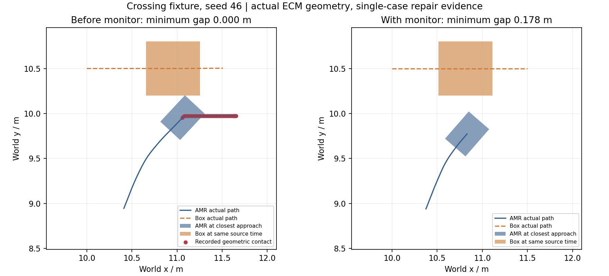

# 动态横穿接触与近障保护修复

2026-10-28，默认RTF1故障矩阵第62个样本（crossing第五轮、seed46）发生真实箱体接触，批次自动停止。此前61个场景断言通过不能掩盖这个失败。原始记录位于`artifacts/validation/m3_dynamic_contact_failure`。

首次接触的Gazebo源时间62.202s，车体中心(11.0604,9.95384)m、yaw0.82174rad；同快照箱体中心约(10.9675,10.5)m，尺寸0.6×0.6m。相邻真值估计车速0.3418m/s。业务以LOADED/FAILED203/HOLD结束。接触判定使用未缩小的0.40×0.30m旋转底盘包络；评估源独立于AMCL。

局部规划带完整足迹和0.12m padding仍不足以覆盖此动态漏防窗口。所有自动导航新增原生Nav2 collision_monitor：直接使用真实激光，0.80×0.64m近障区域至少2点触发停车，按带余量完整足迹预测1.5s碰撞时间减速，0.05s步长；激光源超时0.4s时停车。原有命令新鲜度、独立MotionGuard和业务清理预算保持。

真实原生monitor集成测试验证停车、预测减速、保留原header及激光失效时闭锁。修复后的seed46独立新世界复测运输完成，碰撞0、终态空载、真值和静止检查通过；日志记录Approach→NearStop→恢复正常。箱体在仓库内期间，以同源时间关联实际两物体矩形，最小分离距离约0.178m。这是单例修复证据，完整稳定性需另看正式矩阵。

图由`tools/plot_obstacle_regression.py`从实际truth.jsonl和obstacle_truth.jsonl生成，完整逐样本数值保存在artifacts/validation同名CSV。此图对比添加monitor前后的FastDDS样本；随后Cyclone独立验收另行记录。图中的底盘和箱体显示同一源时间的几何，不使用计划路径或设定箱体位置代替真值。局部图只显示箱体仍在仓库内的交互阶段。

重现修复专项：Windows运行`tools/run_acceptance.ps1 -Stages obstacles -OutputDirectory artifacts/obstacle_recheck -EvidenceName obstacle_recheck`；该阶段分别运行crossing/temporary各5次、seed46–50。最终M3仍独立重新运行正常30单及十五场景各5次，旧正常样本不替代新配置验收。M4两组也共享新增监控层，协议见`experiments/protocol.md`。
